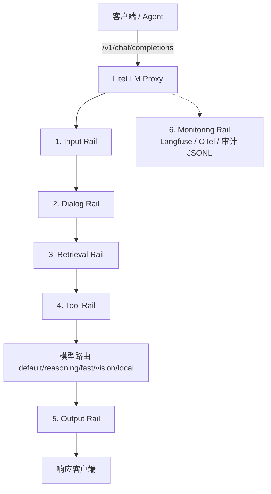
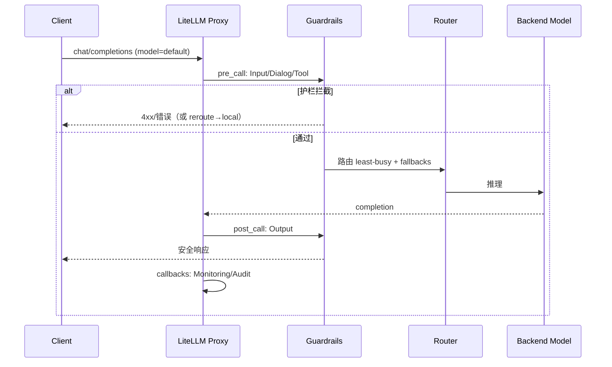
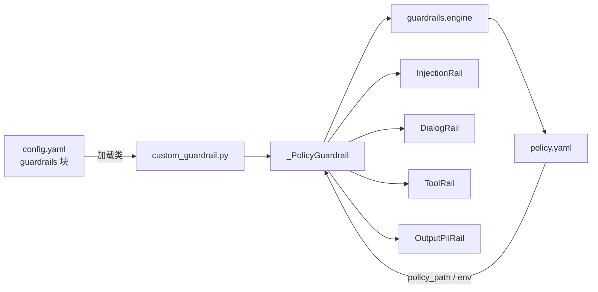

# AI Gateway 六层 Guardrails 分析报告

> 基于本仓库 LiteLLM Proxy 落地实现与 `guardrails/policy.yaml` 策略即代码。  
> 门禁阈值：**越狱绕过 ≤ 2%**、**误报 ≤ 2%**、**PII 泄露 = 0**、**接地性 ≥ 0.9**。  
> 生成日期：2026-08-11（含 `custom_guardrail.py` 代码分析更新）  
> 配套 Word：`docs/six-layer-guardrails-analysis.docx`

---

## 1. 总览

六层 Guardrails（Rails）把 LLM/Agent 请求的风险控制拆成「进模型前 → 对话/检索/工具 → 出模型后 → 运行时观测」的闭环，收口在 LiteLLM Proxy 统一入口。



| 层级 | 时机（LiteLLM） | 文档概念名 | 本仓库落地 |
|------|-----------------|------------|------------|
| Input | `pre_call` | before_call | Presidio、Lakera、`InjectionRail` |
| Dialog | `pre_call` | before_call | `DialogRail` |
| Retrieval | RAG wrapper / 策略字段 | before_call | `policy.yaml` → 业务侧消费 |
| Tool | `pre_call` | before_call | `ToolRail` |
| Output | `post_call` | after_call | LlamaGuard、Bedrock、`OutputPiiRail`(dev) |
| Monitoring | `callbacks` | logging | Langfuse、OTel、`AuditCallback` |

---

## 2. 分层详解

### 2.1 Input Rail（输入护栏）

**目标**：请求进入模型前拦截 PII 与提示注入/越狱。

| 能力 | 实现 | 模式 | 动作 |
|------|------|------|------|
| PII 检测 | Presidio Analyzer/Anonymizer | `pre_call` | 策略默认 `block`（可改 `redact`） |
| 注入/越狱（SaaS） | Lakera | `pre_call` | 拦截不合规输入 |
| 注入/越狱（本地兜底） | `custom_guardrail.InjectionRail` | `pre_call` | 正则命中后 `block`，可选 `on_block_reroute: local` |

**策略摘录**（`policy.yaml` → `rails.input`）：

- PII deny：`PERSON`、`EMAIL_ADDRESS`、`PHONE_NUMBER`、`CREDIT_CARD`、`US_SSN`、`IBAN_CODE`、`BANK_ACCOUNT`
- 注入 deny_patterns：如 `ignore previous instructions`、`jailbreak`、`you are now DAN` 等

**挂载模型**：生产 `default` 全量挂载；`fast`/`local` 至少有 Presidio + Injection。

**风险与缺口**：正则兜底无法覆盖全部越狱变体，生产应保留 Lakera（或等价 LLM-as-judge）；命中后改路由到 `local` 可避免业务硬中断。

---

### 2.2 Dialog Rail（对话护栏）

**目标**：话题边界、轮次上限、语气策略，防止对话漂移到违规域。

| 项 | 配置 |
|----|------|
| 允许话题 | banking / investing / support / general |
| 拒绝话题 | illegal_advice / internal_policy_leak / market_manipulation |
| 最大轮次 | 40 |
| 语气 | professional |

**实现**：`DialogRail`（`pre_call`）读取 `policy.yaml`，用确定性关键词表做 deny_topic 匹配 + 用户轮次计数。

**风险与缺口**：当前为轻量关键词实现，复杂语义漂移需升级为 LLM-as-judge 或 NeMo Guardrails；`allow_topics` 尚未做强制白名单过滤。

---

### 2.3 Retrieval Rail（检索护栏）

**目标**：RAG 场景下保证回答可接地、可引用，并对检索片段脱敏。

| 项 | 配置 |
|----|------|
| grounded_only | true |
| citation_required | true |
| 来源白名单 | kb.internal.example.com、docs.example.com |
| 片段 PII | redact |

**落地状态**：**策略已声明，网关层未做独立 LiteLLM Guardrail Hook**。应由 RAG 检索 wrapper / Agent 工具层在「检索返回后、拼进 prompt 前」执行：

1. 校验 `source` 是否在 allowlist  
2. 对 chunk 做 PII redact  
3. 评估门用 `groundedness ≥ 0.9` 卡发布  

**建议**：补 `RetrievalRail` 或在 `search_knowledge` 工具出口统一校验，否则生产 RAG 易出现「策略有、运行无」。

---

### 2.4 Tool Rail（工具护栏）

**目标**：防止越权 function-call / 危险参数。

| 类型 | 工具名 |
|------|--------|
| 白名单 | lookup_balance、create_ticket、search_knowledge、get_fx_rate |
| 黑名单 | wire_transfer、delete_record、execute_shell、grant_access |
| 需人工审批 | wire_transfer |

**实现**：`ToolRail`（`pre_call` + `async_pre_call_hook`）校验：

- tools / tool_calls 是否在 allowlist、是否命中 deny_list  
- 按 `schemas` 做最小 JSON Schema 校验（required / type / enum / 长度与数值范围）

**风险与缺口**：`human_approval` 目前仅策略声明，未接审批工作流；Agent 若绕过网关直连工具则失效——须强制所有工具调用经 Proxy。

---

### 2.5 Output Rail（输出护栏）

**目标**：模型输出侧安全与合规把关。

| 实现 | 模式 | 用途 |
|------|------|------|
| Llama Guard 2 | `post_call` | 多类安全话题拦截 |
| Bedrock Guardrails | `post_call` | 品牌/合规策略 |
| `OutputPiiRail`（dev） | `post_call` | 正则脱敏 SSN/卡号/邮箱/电话 |

**策略**（`rails.output`）：

- PII：默认 `redact`（非直接 block，兼顾可用性）  
- policy deny：`non_compliant_recommendation`、`guaranteed_return_promise`  
- safety deny：`self_harm`、`harassment`、`violent_crime`

**注意**：流式响应下 `post_call` 多为审计/事后拦截能力有限；实时过滤需 `streaming` 钩子。开发配置用 `OutputPiiRail` 替代 SaaS 输出护栏。

---

### 2.6 Monitoring Rail（监控护栏）

**目标**：全链路可观测、SLO、不可变审计，支撑 MTTD/MTTR。

| 组件 | 作用 |
|------|------|
| Langfuse | Trace / 成功失败回调 |
| OpenTelemetry | Metrics/Traces → otel-collector → Prometheus |
| `AuditCallback` | JSONL 审计：模型、耗时、token、护栏命中、租户 |
| Argo Rollouts Analysis | 金丝雀期误报%/越狱% ≤ 2 自动回滚 |

**SLO（与策略一致）**：

| 指标 | 目标 |
|------|------|
| MTTD | ≤ 5 min |
| MTTR | ≤ 15 min |
| 误报率 | ≤ 2% |
| 越狱绕过 | ≤ 2% |
| PII 泄露 | 0 |
| 审计留存 | ~7 年（2555 天） |

---

## 3. 请求链路时序



**按虚拟模型的护栏厚度**（生产 `config.yaml`）：

| model | Input | Dialog | Tool | Output |
|-------|-------|--------|------|--------|
| default | Presidio+Lakera+Injection | ✓ | ✓ | LlamaGuard+Bedrock |
| reasoning | Presidio+Injection | ✓ | — | LlamaGuard |
| fast | Presidio+Injection | ✓ | — | — |
| vision | Presidio | — | — | LlamaGuard |
| local | Presidio+Injection | ✓ | ✓ | LlamaGuard |

合规敏感流量应优先 `local`，并保证 Input/Output 仍生效。

---

## 4. 策略即代码与质量门

| 资产 | 路径 | 作用 |
|------|------|------|
| 策略 | `guardrails/policy.yaml` | 六层规则唯一事实源 |
| 引擎 | `guardrails/engine.py` | 确定性校验（评估/单测） |
| 适配 | `custom_guardrail.py` | LiteLLM CustomGuardrail |
| 评估门 | `scripts/eval_gate.py` | bypass/FP/PII/groundedness |
| 校验 | `scripts/validate_policy.py` | schema 必填与 allow∩deny |
| 回滚 | `scripts/rollback.py` | 路由降级 / 权重 / 镜像标签 |

变更流程建议：**改 policy → validate + eval_gate + pytest → MR 审批 → GitOps 同步**，禁止生产热改。

---

## 5. 成熟度与改进建议

| 层级 | 成熟度 | 建议 |
|------|--------|------|
| Input | ★★★★☆ | 保留 Lakera；扩充红队样本；Injection 补 `redact` 动作 |
| Dialog | ★★★☆☆ | 引入 LLM-as-judge；落实 allow_topics；关键词迁入 policy |
| Retrieval | ★★☆☆☆ | **优先补齐运行时 Hook/Wrapper**（`custom_guardrail` 尚无此类） |
| Tool | ★★★★☆ | 落地 human_approval（`ToolRail` 未读该字段）；MCP 同样过 Rail |
| Output | ★★★★☆ | 流式 streaming 钩子；`OutputPiiRail` 仅 dev 脱敏 |
| Monitoring | ★★★★☆ | 把护栏 FP/bypass 打成 Prometheus 指标供 Rollouts 消费 |

---

## 6. 金融合规映射（摘要）

| 要求 | 护栏对应 |
|------|----------|
| 数据不出域 | 路由 `local` + Input/Output 仍生效 |
| 可审计 | Audit JSONL + Langfuse + Git 版控策略 |
| 可控变更 | policy MR + Argo CD reconcile |
| 运营韧性 | fallbacks + `rollback.py`（MTTR≤15m） |
| 自动化决策可解释 | 路由键、命中护栏、token 成本留痕 |

相关框架可对齐：EU AI Act、SR 11-7、DORA、MiFID II、GDPR Art.22 等（证据链 = 策略版本 + 评估报告 + 审计日志 + 同步记录）。

---

## 7. `custom_guardrail.py` 代码分析

本模块是 **LiteLLM `CustomGuardrail` 适配层**：不重复实现规则，只把 `guardrails/engine.py` 的确定性逻辑接到 Proxy 的 `apply_guardrail` / `async_pre_call_hook` 生命周期。config 中以 `guardrail: custom_guardrail.<ClassName>` 引用。

### 7.1 架构与职责边界



| 层次 | 文件 | 职责 |
|------|------|------|
| 适配 | `custom_guardrail.py` | 解析 LiteLLM `inputs`/`request_data`，决定 block / redact / reroute，抛 `Exception` 拦截 |
| 引擎 | `guardrails/engine.py` | 纯函数：注入匹配、话题/轮次、工具白黑名单、schema、PII 正则（可单测、可离线评估） |
| 策略 | `guardrails/policy.yaml` | 规则数据；变更不改代码 |

**设计优点**：评估门 `eval_gate.py` 与运行时共用同一套 `engine`，避免「CI 过了、线上另套逻辑」漂移。

### 7.2 公共基础设施

| 符号 | 作用 | 注意点 |
|------|------|--------|
| `_policy_path()` | `policy_path` 参数 → `GUARDRAIL_POLICY_PATH` → 默认 `./guardrails/policy.yaml` | 容器内须挂载 `/app/guardrails/policy.yaml` |
| `_PolicyGuardrail` | 构造时 `load_policy.cache_clear()` 再加载；暴露 `rails` | **每次实例化清缓存**：策略热更友好，但多实例频繁构造时有重复 IO |
| `_texts_from_inputs()` | 优先 `inputs.texts`，否则从 `structured_messages` 抽 string / multimodal text part | 未处理纯 image、tool-only 消息；无文本时下游检查为空操作 |

拦截约定：命中策略时 `raise Exception("Guardrail <name> blocked: ...")`，由 LiteLLM 转成 API 错误返回客户端。

### 7.3 四类 Rail 逐项

#### InjectionRail（Input）

| 项 | 说明 |
|----|------|
| 入口 | `apply_guardrail`，仅 `input_type == "request"` |
| 逻辑 | 对每段文本调用 `check_injection`（`deny_patterns` 子串、小写匹配） |
| 动作 | ① `on_block_reroute` 有值 → 改写 `request_data["model"]` 并写 `metadata.guardrail_reroute`，**放行**；② 否则 `action==block` → 抛异常 |
| 未覆盖 | `action: redact` 在策略可配，但本类未实现脱敏改写，仅 block / reroute |

**代码路径摘要**：

```69:96:custom_guardrail.py
class InjectionRail(_PolicyGuardrail):
    async def apply_guardrail(...):
        # request only → check_injection → reroute or raise
```

#### DialogRail（Dialog）

| 项 | 说明 |
|----|------|
| 入口 | `apply_guardrail`，仅 request |
| 逻辑 | 拼接全部文本 + `structured_messages`/`messages` → `check_dialog`（`max_turns`、deny_topic 关键词表） |
| 动作 | 有 reason 即 raise |
| 未覆盖 | `allow_topics`、`tone` 只在 policy 声明，**代码未强制**；关键词表硬编码在 `engine.DENY_TOPIC_KEYWORDS`，与 policy 话题名耦合 |

```99:114:custom_guardrail.py
class DialogRail(_PolicyGuardrail):
    async def apply_guardrail(...):
        # join texts → check_dialog → raise if blocked
```

#### ToolRail（Tool）— 双入口

| 入口 | 时机 | 检查内容 |
|------|------|----------|
| `apply_guardrail` | pre/post（按 mode） | `tools` 白黑名单；`tool_calls` 名 + `schemas` 参数校验 |
| `async_pre_call_hook` | 请求进模型前 | `data.tools`；`messages[].tool_calls` 名 + 参数（覆盖 Agent 回灌场景） |

Schema 校验走 `parse_tool_args` + `validate_tool_args`（required / type / enum / minLength / maxLength / minimum / maximum）。

| 缺口 | 说明 |
|------|------|
| `human_approval` | policy 有字段，本类**完全未读** |
| 响应侧 tool_calls | 依赖 LiteLLM 把 `tool_calls` 填进 `inputs`；若 provider 结构差异可能漏检 |
| 无 tools 的请求 | `check_tools([])` 直接通过（符合预期） |

```117:193:custom_guardrail.py
class ToolRail(_PolicyGuardrail):
    async def apply_guardrail(...): ...
    async def async_pre_call_hook(...): ...
```

#### OutputPiiRail（Output，偏开发）

| 项 | 说明 |
|----|------|
| 入口 | 仅 `input_type == "response"` |
| 逻辑 | 对 `inputs.texts` 逐段 `redact_pii`（SSN / 卡号 / 邮箱正则，**无电话**——engine 里 Output 路径未含 phone） |
| 动作 | `action==block` 且 hit → raise；`redact` → 写回脱敏文本；其它 action → 保留原文 |
| 范围 | **不实现** policy 中的 `output.policy` / `output.safety` deny 列表（生产靠 LlamaGuard/Bedrock） |

```196:214:custom_guardrail.py
class OutputPiiRail(_PolicyGuardrail):
    async def apply_guardrail(...):
        # response only → redact_pii → block or rewrite texts
```

### 7.4 与 config 的挂载关系

| 类名 | config `guardrail` 值 | 典型 mode | 出现配置 |
|------|----------------------|-----------|----------|
| `InjectionRail` | `custom_guardrail.InjectionRail` | `pre_call` | `config.yaml` / `config.dev.yaml` |
| `DialogRail` | `custom_guardrail.DialogRail` | `pre_call` | 同上 |
| `ToolRail` | `custom_guardrail.ToolRail` | `pre_call` | 同上 |
| `OutputPiiRail` | `custom_guardrail.OutputPiiRail` | `post_call` | **仅** `config.dev.yaml`（生产用 LlamaGuard/Bedrock） |

本文件**不包含** Retrieval / Monitoring：检索仍属 RAG wrapper；监控在 `custom_callbacks.py`。

### 7.5 正确性与工程质量评估

| 维度 | 评价 | 依据 |
|------|------|------|
| 分层 | 优 | 适配与引擎分离，单测不依赖 LiteLLM |
| 策略驱动 | 良 | 多数规则来自 YAML；deny_topic 关键词仍硬编码 |
| 拦截一致性 | 良 | 统一 Exception 消息前缀，便于审计检索 |
| 改路由 | 有 | Injection 支持合规降级，优于一律 500 |
| 异常类型 | 弱 | 裸 `Exception`，未用 LiteLLM 专用 Guardrail 异常码 |
| 策略缓存 | 中 | 每次构造 `cache_clear`，正确但偏重 |
| 覆盖面 | 中 | 无 RetrievalRail；Dialog allow/tone、Tool 审批、Output policy/safety 未落地 |
| 流式 | 缺 | 无 `async_post_call_streaming_iterator_hook`，OutputPii 对流式实时脱敏无效 |

### 7.6 针对本文件的改进建议（优先级）

1. **P0**：`ToolRail` 读取 `human_approval`，命中时标记 metadata / 拒绝自动执行，对接审批流  
2. **P0**：补 `RetrievalRail`（或明确文档「仅 RAG 侧」并在 `search_knowledge` 出口强制校验）  
3. **P1**：`DialogRail` 落实 `allow_topics`；把 `DENY_TOPIC_KEYWORDS` 迁入 `policy.yaml`  
4. **P1**：Injection 支持 `action: redact`；统一使用 LiteLLM 推荐的拦截异常类型  
5. **P2**：`OutputPiiRail` 对齐 engine 电话正则；可选 streaming 钩子  
6. **P2**：策略加载改为 mtime 失效缓存，避免每次构造全量清缓存  

---

## 8. 结论

本仓库已在 LiteLLM 层落地 **Input / Dialog / Tool / Output / Monitoring** 五层可执行护栏，其中 **Input/Dialog/Tool/Output(dev) 的自定义部分由 `custom_guardrail.py` 适配、`engine.py` 执行**。**Retrieval** 仍以策略声明为主、运行时需 RAG 侧补齐。六层形成「进站过滤 → 能力约束 → 出站把关 → 持续观测」闭环，评估门锁定越狱/误报/PII/接地性。

**一句话**：路由决定「走哪台模型」，六层 Rails 决定「能不能走、怎么走、走完是否合规」；`custom_guardrail.py` 是自定义 Rails 接到 LiteLLM 生命周期的薄适配层。
