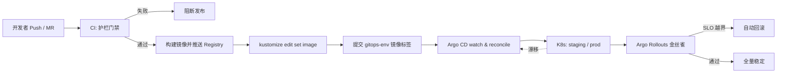

# DevGuard 工作流程总览

> AI Guardrails + Argo CD Native GitOps  
> 仓库：`http://10.65.16.39:3000/EHui/claw-agent.git`（monorepo：`app-source/` + `gitops-env/`）

本文描述项目端到端工作流：从代码变更 → 护栏门禁 → 写环境清单 → Argo CD 同步 → 金丝雀与回滚。

---

## 1. 核心原则

| 原则 | 含义 |
|---|---|
| Git 是唯一事实源 | 集群期望状态 = `gitops-env` 中的清单 |
| CI 不直接部署 | CI 只做构建 + 护栏门禁；通过后才改镜像标签 |
| 门禁失败即阻断 | 不写环境仓 → Argo CD 无新 revision → 不部署 |
| 漂移自愈 | prod Application `selfHeal: true`，手动改集群会被拉回 |
| 运行时越界回滚 | Argo Rollouts Analysis 失败 → 回退稳定 ReplicaSet |

---

## 2. 端到端总览



**一句话**：门禁过了才改 Git；改了 Git，Argo CD 才会改集群。

---

## 3. 仓库分工

```
DevGuard / claw-agent
├── app-source/          # 应用 + 策略 + 评估 + CI 脚本（构建侧）
│   ├── guardrails/policy.yaml
│   ├── eval/            # 回归集 / 红队集 / 门阈值
│   ├── scripts/         # validate / eval / redteam / check_*
│   ├── src/main.py      # FastAPI 运行时护栏 + Prometheus 指标
│   ├── tests/guardrails/
│   ├── Dockerfile
│   └── Jenkinsfile
├── gitops-env/          # 环境清单（Argo CD 读取的唯一事实源）
│   ├── base/            # Rollout / Service / ConfigMap / AnalysisTemplate
│   ├── envs/staging/
│   ├── envs/prod/
│   ├── argocd/          # AppProject + Application
│   └── gatekeeper/      # 准入约束
├── .github/workflows/ci.yml
└── docs/
```

| 目录 | 谁写 | 谁读 |
|---|---|---|
| `app-source/` | 开发者 / CI 构建 | CI、运行时镜像 |
| `gitops-env/` | CI（改 image tag）/ 运维 MR（策略与拓扑） | Argo CD |

---

## 4. 开发与发布工作流（主路径）

### 阶段 A — 变更准入（本地 / MR）

1. 修改应用代码、`guardrails/policy.yaml` 或评估集。
2. 本地先跑门禁（可选但推荐）：

```bash
cd app-source
pip install -r requirements.txt
python scripts/validate_policy.py guardrails/policy.yaml
pytest tests/guardrails/ -q
python scripts/eval.py --out reports/eval.json
python scripts/check_gate.py --report reports/eval.json --max-bypass 2 --max-fp 2
python scripts/redteam.py --out reports/redteam.json
python scripts/check_redteam.py --report reports/redteam.json
```

3. 提交 MR → 评审（策略变更建议强制审批）。

### 阶段 B — CI 护栏门禁（GitHub Actions / Jenkins）

触发：`push` 到 `main` 或 PR（见 `.github/workflows/ci.yml` / `Jenkinsfile`）。

| 顺序 | 步骤 | 脚本 / 动作 | 失败后果 |
|---|---|---|---|
| 1 | 策略 schema 校验 | `validate_policy.py` | 阻断 |
| 2 | Prompt lint | `lint_prompts.py` | 阻断 |
| 3 | 策略单测 | `pytest tests/guardrails/` | 阻断 |
| 4 | 离线评估 | `eval.py` + `check_gate.py` | 阻断 |
| 5 | 红队对抗 | `redteam.py` + `check_redteam.py` | 阻断 |
| 6 | 构建镜像 | `docker build`（tag = commit 短哈希） | 阻断 |
| 7 | 推送镜像 | `docker push`（仅 main） | 阻断 |
| 8 | 晋级清单 | `kustomize edit set image` 并 commit `gitops-env` | 无新部署 |

**门禁阈值（与 Deck 一致）**

| 指标 | 上限 |
|---|---|
| 越狱绕过率 `jailbreak_bypass_pct` | ≤ 2% |
| 误报率 `false_positive_pct` | ≤ 2% |
| PII 泄露 `pii_leak_pct` | = 0% |

### 阶段 C — GitOps 晋级（写环境仓）

门禁通过且分支为 `main` 时：

```bash
cd gitops-env/envs/prod   # 或 staging
kustomize edit set image \
  registry.internal.example.com/ai/ai-guardrails=\
  registry.internal.example.com/ai/ai-guardrails:<SHORT_SHA>
git commit -m "promote ai-guardrails:<SHORT_SHA>"
git push
```

- **推荐（金融场景）**：门禁驱动写标签（方式 A）。  
- **不推荐默认开启**：Image Updater 全自动追新（方式 B），升级权应留在门禁之后。

### 阶段 D — Argo CD 调和

| Application | path | 自动化策略 |
|---|---|---|
| `ai-guardrails-staging` | `gitops-env/envs/staging` | auto-sync；`selfHeal: false`（便于调试） |
| `ai-guardrails-prod` | `gitops-env/envs/prod` | auto-sync；`selfHeal: true`；prune |

流程：

1. Argo CD 拉取 `claw-agent`（需仓库凭据 Secret）。
2. 对 path 执行 `kustomize build`。
3. 与集群 live 状态对比 → `Synced` / `OutOfSync`。
4. 自动 sync：创建命名空间、应用 Rollout / Service / ConfigMap / AnalysisTemplate。

Web UI：

```bash
kubectl -n argocd port-forward svc/argocd-server 8080:443
# 浏览器打开 https://localhost:8080
```

### 阶段 E — 渐进交付（Argo Rollouts）

`base/rollout.yaml` 金丝雀步骤（prod 示意）：

1. `setWeight: 20` → pause 5m → Analysis `guardrail-slo`
2. `setWeight: 50` → pause 5m → Analysis `guardrail-slo`
3. `setWeight: 100`

Analysis 查询 Prometheus（示意）：

- `guardrail_false_positive_total` → FP% ≤ 2
- `guardrail_jailbreak_bypass_total` → 越狱绕过% ≤ 2

越界 → 中止晋级并回滚到稳定 ReplicaSet（目标 MTTD ≤ 5min / MTTR ≤ 15min）。

### 阶段 F — 准入护栏（Gatekeeper，可选）

`gitops-env/gatekeeper/`：

- 生产 Rollout **必须**挂载 ConfigMap `guardrail-policy`
- **禁止**镜像 tag `latest`

防止绕过 CI 的违规清单进入集群。

---

## 5. 六层 Rails → 工作流映射

| Rail | 主要落地位置 | 形式 |
|---|---|---|
| Input | CI `validate` + `eval`；运行时 `/v1/guard` | schema / PII / 注入拦截 |
| Dialog | CI `eval` + `redteam` | 主题白/黑名单 |
| Retrieval | CI `eval`（接地性等） | grounded / citation |
| Tool | 策略单测 + Gatekeeper / 运行时 tool 校验 | allowlist / deny_list / 人工审批 |
| Output | CI `eval` + 运行时 redact/block | PII 脱敏、安全策略 |
| Monitoring | Rollouts Analysis + Argo CD sync health | 漂移检测、自动回滚 |
| （跨层）策略即代码 | `policy.yaml` → ConfigMap，经 Git 版本化 | MR + 审计 |

---

## 6. 回滚工作流

| 场景 | 做法 |
|---|---|
| 应用版本回退 | `argocd app rollback ai-guardrails-prod <rev>` 或 `git revert` 环境仓提交 |
| 金丝雀失败 | Rollouts 自动回退稳定 RS（无需人工） |
| 集群被手改 | prod `selfHeal` 拉回 Git；或 UI 中 Sync |
| 策略回退 | revert `policy.yaml` / ConfigMap 相关 commit → Argo CD sync |

---

## 7. 日常运维工作流

### 7.1 查看同步状态

```bash
kubectl -n argocd get applications -o wide
kubectl -n argocd get application ai-guardrails-prod -o yaml | findstr /i "sync health message"
```

### 7.2 硬刷新

```bash
kubectl -n argocd annotate application ai-guardrails-prod \
  argocd.argoproj.io/refresh=hard --overwrite
```

### 7.3 验证自愈

```bash
kubectl -n ai-guardrails-prod scale rollout ai-guardrails --replicas=1
# 数分钟内应被 selfHeal 拉回 Git 声明副本数
```

### 7.4 密钥

- LLM / 仓库密钥：External Secrets / SealedSecrets（示例见 `gitops-env/base/external-secret.example.yaml`）
- Argo CD 拉仓：只读凭据；写环境仓权限仅给 CI

---

## 8. 角色与权限（建议）

| 角色 | 可做 | 不可做 |
|---|---|---|
| 开发 | 改 `app-source`、开 MR | 直接改 prod 集群 |
| CI 服务账号 | 推镜像、在门禁通过后改 image tag | 绕过门禁写 prod |
| 平台 / SRE | 管 Argo CD、Rollouts、Gatekeeper | 无审计地手改 prod 清单外状态 |
| 合规 | 只读评估报告与 sync 历史 | — |

---

## 9. 证据链（合规）

每次发布应能串起：

1. Git commit（应用 + 策略）  
2. CI 报告：`reports/eval.json`、`reports/redteam.json`  
3. 不可变镜像 tag = commit 短哈希  
4. `gitops-env` 中对应 image tag 的 commit  
5. Argo CD sync revision + 操作记录  
6. （可选）Rollouts Analysis 结果  

对应金融场景可控变更与审计要求（如 SR 11-7 / DORA / MiFID II / GDPR Art.22）。

---

## 10. 相关文档

| 文档 | 内容 |
|---|---|
| [README.md](../README.md) | 快速开始与目录说明 |
| [gitops-env/README.md](../gitops-env/README.md) | 环境仓操作 |
| [argocd-claw-agent-setup.md](./argocd-claw-agent-setup.md) | 本机 minikube 挂接 claw-agent 的实操记录 |

---

## 11. 流程速记（给值班）

```text
代码变更
  → CI 门禁（策略/单测/评估/红队）
    → 构建并推送镜像
      → 更新 gitops-env 镜像标签并 push
        → Argo CD 自动 sync
          → Rollouts 金丝雀 + SLO
            → 成功：全量；失败：自动回滚
```

**任何一步失败，都不应该出现“集群已是新版本、Git 却不是”的状态。**
