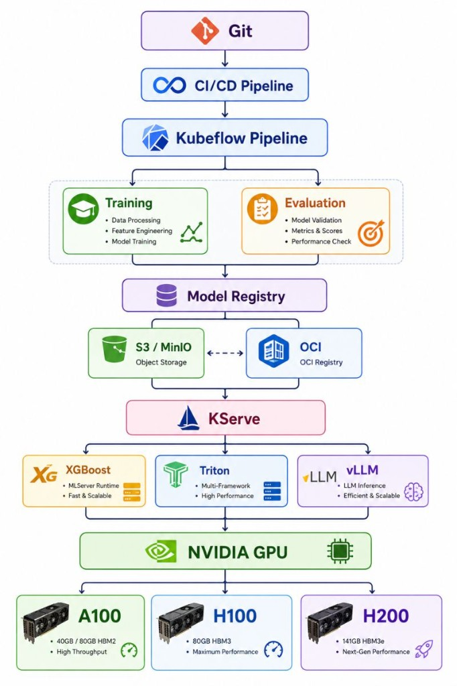

# AI/ML Factory — Production path from Git Commit to NVIDIA GPU

```
Git → CI/CD → Kubeflow → Model Registry → KServe → Inference Runtime → NVIDIA GPU
```



这是一套**可部署到 Kubernetes 的生产级工程骨架**，不是进程内模拟。它落实同一条原则：

> **Don't treat the model as a container. Treat the model as a versioned artifact.**

训练在 Kubeflow 上产出制品 → 写入 MinIO/S3 与 MLflow Registry → KServe 通过 `storageUri` / PVC / OCI 拉取权重 → 绑定 XGBoost / Triton / vLLM → 调度到 A100 / H100 / H200。

本地叙事演示见姊妹项目 [git-to-gpu](../git-to-gpu/)。本仓库是可落地的 manifests + pipelines + CI。

## 技术栈

| 层 | 技术 |
|---|---|
| Git + CI/CD | GitHub Actions、Tekton Pipeline |
| 训练编排 | Kubeflow Pipelines v2（可编辑 Spec + 组件库 → IR） |
| 制品仓 | MinIO（S3）、MLflow Model Registry、OCI（oras Job） |
| 服务 | KServe InferenceService |
| 运行时 | XGBoost · NVIDIA Triton · vLLM |
| GPU | RuntimeClass `nvidia`、nodeSelector、ResourceQuota |
| GitOps | Argo CD Applications + Kustomize overlays（dev/staging/prod） |
| 可观测 / FinOps | ServiceMonitor 占位、GPU quota 标签约定 |

## 仓库结构

```
ai-ml-factory/
├── console/                   # FastAPI 控制台 API（本机 :8006）
├── frontend/                  # 控制台 UI
├── pipelines/                 # Scheme B: specs + components + from_spec 编译器
│   ├── specs/                 # 可编辑 DAG YAML
│   ├── components/            # 组件库
│   ├── compiler/              # validate + compile → compiled/
│   └── compiled/              # KFP IR 产物
├── training/                  # xgboost / pytorch 训练入口 + Dockerfile
├── registry/scripts/          # 制品上传到 MinIO/S3
├── serving/
│   ├── xgboost/               # KServe + storageUri
│   ├── triton/                # Triton model repository + GPU ISVC
│   └── vllm/                  # vLLM + PVC/OCI sync
├── manifests/
│   ├── minio/ · mlflow/ · gpu/
│   └── overlays/{dev,staging,prod}
├── cicd/tekton/               # Tekton CI Pipeline
├── gitops/argocd/             # Argo CD Apps
├── .github/workflows/ci.yml
├── docs/deploy.md
└── tests/
```

## 控制台（前端）

```bash
cd ai-ml-factory
pip install -r requirements.txt
python console/main.py
# 打开 http://localhost:8006
```

页面：

| Tab | 能力 |
|---|---|
| **架构** | 垂直流水线 + 工程入口 |
| **Pipeline 编辑** | 方案 B：编辑 Spec DAG / 参数 → 校验 → 编译 KFP IR |
| **训练 / Kubeflow** | 一键本地训练，写入版本化 `artifacts/` |
| **Model Registry** | 浏览本地制品与 s3:// URI |
| **KServe** | 展示 InferenceService 清单并试推理 |
| **清单** | serving / registry / gitops / overlays 路径 |

编译 Pipeline（需 `kfp`）：

```bash
python -m pipelines.compiler --list
python -m pipelines.compiler fraud-default
```

有 `kubectl` 且集群可达时，会探测 `kserve-demo` 命名空间；否则纯本地模式仍可完整演示。

## 快速开始（本地门禁）

无需集群即可验证训练与清单：

```bash
cd ai-ml-factory
python3 -m venv .venv && source .venv/bin/activate
pip install -r requirements.txt

pytest -q tests/
python training/xgboost/train.py --out-dir artifacts/fraud-xgb/v1.0.0
python console/main.py   # UI: http://localhost:8006
```

## 部署到集群

详见 [docs/deploy.md](./docs/deploy.md)。  
各模块技术实现与代码对照见 [docs/MODULES.md](./docs/MODULES.md)。

摘要：

```bash
# 1) Registry
kubectl apply -f manifests/base/namespaces.yaml
kubectl apply -f manifests/minio/minio.yaml
kubectl apply -f manifests/mlflow/mlflow.yaml

# 2) 上传版本化制品（模型 ≠ 容器）
kubectl -n ml-registry port-forward svc/minio 9000:9000
python registry/scripts/upload_artifact.py \
  --src artifacts/fraud-xgb/v1.0.0 \
  --s3-uri s3://ai-factory/models/fraud-xgb/v1.0.0

# 3) 提交 Kubeflow Pipeline（在装有 KFP 的集群）
# 上传 pipelines/compiled/ai-ml-factory-train-register.yaml

# 4) KServe
kubectl apply -k manifests/overlays/staging
kubectl -n kserve-demo get inferenceservices
```

## 三条推理路径

| Runtime | 工作负载 | 制品来源 | GPU |
|---|---|---|---|
| **XGBoost** | 经典 ML | `s3://…/fraud-xgb/v1.0.0/` | 否 |
| **Triton** | 多框架 DL | `s3://…/vision-resnet/v1.0.0/` | A100 |
| **vLLM** | LLM | PVC / OCI `assist-llm:v1.0.0` | H100 → H200（prod overlay） |

## 环境差异（Kustomize）

| Overlay | 行为 |
|---|---|
| `dev` | vLLM `minReplicas=0`，A100 |
| `staging` | XGBoost 扩到 2–10；vLLM 固定 1，H100 |
| `prod` | vLLM min=2，H200；GPU quota 提到 16 |

## 核心设计约束

1. **Serving 镜像不烤模型权重** — InferenceService 引用 `storageUri` / PVC。
2. **评估门禁不过不注册** — KFP `evaluate_model` 失败则不写 Registry。
3. **运行时可替换** — 同一制品可换 Triton / vLLM（换 YAML，不重训）。
4. **GPU 代际可替换** — overlay 改 `nodeSelector`，不改模型。

## 下一步演进

- DCGM Exporter + Grafana GPU 面板  
- OpenCost / Kubecost 做 `$/1k tokens` 归因  
- 多租户 NetworkPolicy + 命名空间配额  
- KServe InferenceGraph / canary + 模型 SLO  

## 与集合内其它项目

| 项目 | 关系 |
|---|---|
| [git-to-gpu](../git-to-gpu/) | 同架构的交互式叙事演示 |
| [k8sdevops](../k8sdevops/) | Tekton + Argo CD 通用 GitOps |
| [ai-cluster-gateway](../ai-cluster-gateway/) | 多集群推理路由（可接本仓库的 KServe 端点） |
| [gpu-allocator](../gpu-allocator/) | GPU 卡级分配 |

## License

MIT（随集合仓库）
