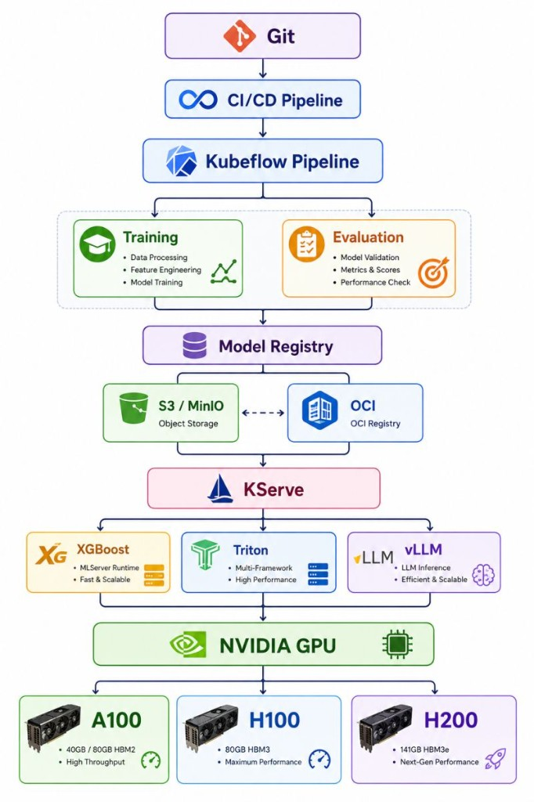

# Git → GPU AI Factory

**From Git Commit to NVIDIA GPU: What a Production AI/ML Platform Actually Looks Like**

训练模型只是旅程的一部分。真正的工程挑战，是搭一条**可重复、可扩展、可迁移**的路径：从模型开发走到生产推理。

```
Git → CI/CD → Kubeflow → Model Registry → KServe → Inference Runtime → NVIDIA GPU
```



## 核心原则

> **Don't treat the model as a container. Treat the model as a versioned artifact.**

模型是版本化制品，不是容器。这样你才能：

- 在一个 OpenShift / Kubeflow 集群上训练
- 独立存储模型与元数据（S3/MinIO 或 OCI）
- 跨环境迁移
- 通过 KServe 部署
- 按需切换推理运行时
- 针对不同 NVIDIA GPU 代际优化

这是企业 **AI Factory** 的底座：可复现 ML 流水线 + 模型治理 + 可移植制品 + Kubernetes 原生服务 + GPU 感知基础设施。

## 各层做什么

| 层 | 贡献 |
|---|---|
| **Git + CI/CD** | 版本控制、自动化测试、代码打包、可复现部署 |
| **Kubeflow Pipelines** | 数据处理、分布式训练、实验、模型评估 |
| **Model Registry** | 版本化制品与元数据（S3/MinIO · OCI） |
| **KServe** | K8s 原生服务、扩缩容、灰度、推理端点 |
| **Inference Runtimes** | XGBoost（经典 ML）· Triton（多框架）· vLLM（LLM） |
| **NVIDIA GPU** | CUDA Cores → Tensor Cores → HBM → NVLink；A100 → H100 → H200 |

下一步演进：GPU 可观测性、成本归因、多租户、模型性能 SLO、FinOps —— 让 AI 基础设施成为工程学科，而不只是工具堆砌。

## 快速开始

```bash
cd git-to-gpu
pip install -r requirements.txt
python backend/main.py
```

打开 [http://localhost:8005](http://localhost:8005)

演示能力（本地进程内模拟，无需真实 Kubeflow / KServe / GPU）：

1. **架构流水线** — 对齐参考图的垂直分层
2. **跑通一次** — 端到端：Git → … → GPU，产出版本化制品 + InferenceService
3. **Model Registry** — 在 S3 ↔ OCI 间迁移制品，再重新部署
4. **KServe 推理** — 对已部署服务发起模拟推理

## API

| 方法 | 路径 | 说明 |
|------|------|------|
| GET | /api/overview | 架构 + 制品 + 服务 + 运行 |
| POST | /api/runs | 启动端到端流水线 |
| GET | /api/runs/{id} | 流水线状态 / 日志 |
| GET | /api/artifacts | 版本化模型制品 |
| POST | /api/artifacts/{id}/migrate | S3 ↔ OCI 迁移 |
| POST | /api/artifacts/{id}/deploy | 创建 KServe InferenceService |
| POST | /api/services/{id}/infer | 模拟推理 |

启动流水线示例：

```bash
curl -X POST http://localhost:8005/api/runs \
  -H "Content-Type: application/json" \
  -d '{"name":"assist-llm","runtime":"vllm","gpu":"h100","storage":"oci"}'
```

## 项目结构

```
git-to-gpu/
├── backend/
│   ├── main.py       # FastAPI
│   └── factory.py    # 流水线 / 制品 / 服务状态机
├── frontend/
│   └── index.html    # 架构控制台
├── architecture.png  # 参考架构图
├── data/             # 运行时状态
└── README.md
```

## 与仓库其它项目的关系

| 项目 | 关系 |
|------|------|
| [k8sdevops](../k8sdevops/) | CI/CD / GitOps 实践 |
| [ai-cluster-gateway](../ai-cluster-gateway/) | 多集群推理路由与部署 |
| [gpu-allocator](../gpu-allocator/) | GPU 资源分配 |
| [AIGateway](../AIGateway/) | 推理网关 + 护栏 |

本项目侧重 **端到端平台叙事与制品治理模型**；可部署的 Kubeflow / KServe / MinIO 工程见 [ai-ml-factory](../ai-ml-factory/)。其它项目分别深入网关、多集群与 GPU 运维。
