# Legal Agent MCP 架构文档

> 基于本地仓库 `/Users/yudong/AI-Coding/legal-agent-mcp` 与 `/Users/yudong/AI-Coding/legal-agent` 源码梳理  
> 文档日期：2026-08-24

---

## 1. 概述

**legal-agent-mcp** 是一个独立的 [Model Context Protocol (MCP)](https://modelcontextprotocol.io/) Server，将 Legal Agent 后端能力以标准 MCP 工具形式暴露给 AI 客户端（Cursor、Codex、DeepSeek Harness 等）。

| 维度 | 说明 |
|------|------|
| 定位 | MCP 适配层 / 协议桥接器，不承载业务逻辑 |
| 实现语言 | TypeScript (Node.js >= 20) |
| 传输方式 | stdio（标准输入输出 JSON-RPC） |
| 依赖后端 | Legal Agent FastAPI 服务（默认 `:8010`） |
| MCP SDK | `@modelcontextprotocol/sdk` |
| 参数校验 | Zod |

**设计原则：**

- **薄适配层**：MCP Server 只做协议转换与 HTTP 封装，法律推理、文档解析、比对算法均在 Legal Agent 后端完成。
- **stdio 优先**：与 Cursor / Codex 等客户端的 MCP 集成模式一致，无需额外端口。
- **延迟认证**：启动时不强制登录；首次调用需鉴权的 API 时才获取 JWT。
- **工具粒度对齐业务**：6 个 MCP 工具直接映射 Legal Agent 的核心 API，便于 LLM 理解与调用。

### 1.1 LLM 与 MCP 的关系

**结论：LLM 不直接调用 MCP。** MCP 协议由 **MCP Host 内部的 MCP Client** 执行；LLM 只负责「决策是否用工具、用什么参数」，以及「阅读工具返回结果并生成回复」。

#### MCP Server、MCP Client、MCP Host 分别是什么

在本项目场景中，三者的对应关系如下：

| 概念 | 在本项目里是谁 | 干什么 |
|------|----------------|--------|
| **MCP Server** | `legal-agent-mcp`（`node dist/index.js` 子进程） | 对外提供 6 个法律工具；响应 `tools/list`、`tools/call` |
| **MCP Client** | Cursor / Codex / DSH **内置的 MCP 客户端模块** | 连接 MCP Server；发 JSON-RPC；把 tool result 交回 Host |
| **MCP Host** | **整个宿主应用**（如 Cursor IDE） | 管理 LLM 对话、spawn MCP Server、协调 LLM 与 MCP Client |

```
┌─────────────────────────────────────────────────────────┐
│  MCP Host（宿主应用：Cursor / Codex / DeepSeek Harness）   │
│                                                          │
│  ┌──────────┐         ┌─────────────────────────────┐   │
│  │   LLM    │◄───────►│  MCP Client（Host 内置模块）  │   │
│  │ 对话模型  │ tool    │  · spawn MCP Server 子进程    │   │
│  │          │ call/   │  · stdio 发 JSON-RPC          │   │
│  │          │ result  │  · 解析 tools/call 响应        │   │
│  └────▲─────┘         └──────────────┬──────────────┘   │
│       │                              │ stdio (MCP)       │
│  ┌────┴─────┐                        │                   │
│  │   用户    │                        │                   │
│  └──────────┘                        │                   │
└──────────────────────────────────────┼───────────────────┘
                                       ▼
                        ┌──────────────────────────┐
                        │  MCP Server               │
                        │  legal-agent-mcp          │
                        └────────────┬─────────────┘
                                     │ HTTP
                                     ▼
                        ┌──────────────────────────┐
                        │  Legal Agent 后端 (:8010) │
                        └──────────────────────────┘
```

**分工要点：**

- **MCP Server**（legal-agent-mcp）：被动等待请求，只认 MCP 协议，**不知道 LLM 的存在**。
- **MCP Client**：Host 里的「连接器」，负责协议层通信；**不是 LLM**，也**不是** legal-agent-mcp。
- **MCP Host**：对用户可见的整个应用（如 Cursor）；**包含** LLM + MCP Client + UI + 配置；决定何时问 LLM、何时调 MCP、如何把结果塞回对话。

MCP 规范术语是 **Client ↔ Server** 一对；**Host** 是工程/产品侧说法，指承载 Client、LLM 与用户的宿主应用。

> **一句话**：Host（Cursor）雇 LLM 做决策，雇 MCP Client 当跑腿去调 MCP Server（legal-agent-mcp），MCP Server 再调 Legal Agent 干正活。

#### 一次请求的完整分工（legal_search）

| 步骤 | 执行者 | 动作 |
|------|--------|------|
| 1 | Host | 把用户消息 + 工具列表发给 LLM |
| 2 | LLM | 返回 tool call 意图：`legal_search({ query: "…" })` |
| 3 | Host | 将 LLM 意图交给内部 MCP Client |
| 4 | MCP Client | stdio 发 `tools/call` → legal-agent-mcp |
| 5 | MCP Server | 调 Legal Agent HTTP API，返回 Markdown |
| 6 | MCP Client | 把 tool result 交回 Host |
| 7 | Host | 将 tool result 注入 LLM 上下文 |
| 8 | LLM | 组织成自然语言回复 |
| 9 | Host | 展示给用户 |

LLM 参与步骤 2、8；MCP Client 参与 4、6；MCP Server 参与 5。

#### 三层协议边界

```
用户 ←→ LLM           对话（自然语言 / tool call 意图）
LLM  ←→ MCP Host     工具清单 + tool call 请求 + tool result 消息
Host ←→ MCP Server   MCP 协议（stdio JSON-RPC：tools/list · tools/call）
                      ↑ 实际由 Host 内的 MCP Client 发送
MCP  ←→ Backend      HTTP/REST（Legal Agent API）
```

| 角色 | 职责 | 不负责 |
|------|------|--------|
| **LLM** | 理解用户意图；输出 tool call 意图（工具名 + 参数）；整合 tool result 生成最终回复 | 不连接 MCP Server；不发送 stdio/HTTP；不持有 JWT |
| **MCP Host** | 管理对话与 UI；spawn MCP Server；协调 LLM 与 MCP Client；将 tool result 注入 LLM 上下文 | 不直接实现 MCP 协议细节；不实现法律业务逻辑 |
| **MCP Client** | `tools/list` 发现工具；执行 `tools/call`；stdio JSON-RPC 通信 | 不做法律推理；不替代 LLM 决策 |
| **MCP Server**（legal-agent-mcp） | MCP ↔ HTTP 协议转换；参数校验；JWT 管理 | 不做法律推理；不连接对话 LLM |
| **Legal Agent 后端** | 检索、问答、合同审核等业务能力 | 不感知 MCP 协议 |

#### 完整调用链（以 Cursor + legal_search 为例）

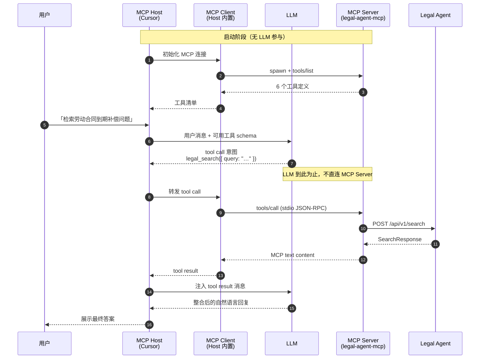

#### LLM 侧看到的 vs Host 侧执行的

LLM 输出的是**结构化意图**（由 Host 解析），例如：

```json
{
  "name": "legal_search",
  "arguments": { "query": "劳动合同到期补偿", "search_type": "comprehensive" }
}
```

Host（Cursor/Codex/DSH）将其翻译为 MCP 请求：

```json
{
  "method": "tools/call",
  "params": {
    "name": "legal_search",
    "arguments": { "query": "劳动合同到期补偿", "search_type": "comprehensive" }
  }
}
```

两者格式相似，但**传输路径不同**：前者在 Host↔LLM 对话通道内，后者在 Host↔MCP Server 的 stdio 通道内。

#### 常见误解

| 误解 | 实际情况 |
|------|----------|
| LLM 直接连 legal-agent-mcp | LLM 只与 MCP Host 通信；由 Host 内的 **MCP Client** 连接 MCP Server |
| MCP Client 就是 LLM | Client 是协议执行者；LLM 是决策者，二者都在 Host 内但职责不同 |
| MCP Host 与 MCP Client 是同一东西 | Host 是整应用；Client 是 Host 内部专门连 MCP Server 的模块 |
| legal-agent-mcp 是 MCP Client | legal-agent-mcp 是 **MCP Server**；Cursor 等应用内置 Client |
| Legal Agent 后端是 MCP Server | 后端是普通 HTTP API；MCP Server 是 legal-agent-mcp |
| MCP Server 调用对话 LLM | legal-agent-mcp 只调 Legal Agent HTTP API；后端 `llm_service` 里的 LLM 是业务 LLM（另一层） |
| 配置 MCP 后 LLM 自动拥有法律能力 | Host 需先 `tools/list`，再把工具 schema 注入 LLM 上下文；LLM 仍需决策是否调用 |
| 用户绕过 Host 直接调 MCP | 可以手动跑 MCP Server，但正常使用场景下 Host 管理其生命周期与 stdio |

#### 与 Legal Agent 后端 LLM 的区别

系统中存在**两个 LLM 接入点**，不要混淆：

1. **对话 LLM**（Cursor/Codex 内置）：决定是否调用 MCP 工具、如何回复用户。
2. **业务 LLM**（Legal Agent `llm_service`）：执行法律检索、问答、合同审核等生成任务。

```
对话 LLM ──(tool call)──→ MCP Host ──(MCP)──→ legal-agent-mcp ──(HTTP)──→ Legal Agent
                                                                                  │
                                                                                  ▼
                                                                            业务 LLM (OpenAI)
```

### 1.2 MCP 调用链代码模块映射

以下按 **legal_search** 完整链路展开，其他工具见 [工具级映射表](#124-工具级代码映射表)。带 `[外部]` 标记的模块不在 `legal-agent-mcp` 仓库内，但属于真实调用链的一部分。

#### 1.2.1 全链路模块总览

```
┌─────────────────────────────────────────────────────────────────────────────┐
│ MCP Host + MCP Client [外部]                                                 │
│  Cursor IDE / Codex CLI / DSH                                               │
│  DSH 参考：deepseek-harness-master/packages/mcp/mcp-client/                  │
│    connection.ts  spawn + Client 连接                                        │
│    tools.ts       listToolsUncached / callToolUncached → tools/call          │
│    transport.ts   StdioClientTransport 子进程                                 │
└───────────────────────────────┬─────────────────────────────────────────────┘
                                │ stdio JSON-RPC
┌───────────────────────────────▼─────────────────────────────────────────────┐
│ legal-agent-mcp（本仓库）                                                    │
│  src/index.ts           MCP Server 入口 · SDK Server + StdioServerTransport │
│  src/tools.ts           handleToolCall · TOOL_DEFINITIONS · Zod 校验        │
│  src/legal-client.ts    LegalAgentClient · fetch HTTP · JWT                  │
│  node_modules/@modelcontextprotocol/sdk   JSON-RPC 编解码 [依赖]             │
└───────────────────────────────┬─────────────────────────────────────────────┘
                                │ HTTP/REST
┌───────────────────────────────▼─────────────────────────────────────────────┐
│ legal-agent backend [外部]                                                   │
│  app/main.py            FastAPI 入口 · 路由挂载                              │
│  app/api/v1/__init__.py prefix=/api/v1                                      │
│  app/api/v1/auth.py     POST /auth/login                                    │
│  app/api/v1/legal.py    POST /search · /chat                                │
│  app/api/deps.py        get_current_user · JWT 校验                         │
│  app/services/llm_service.py   legal_search · chat_reply · OpenAI/Mock      │
│  app/schemas/schemas.py        SearchRequest / SearchResponse               │
└─────────────────────────────────────────────────────────────────────────────┘
```

#### 1.2.2 legal_search 逐步代码追踪

| 步骤 | 层级 | 模块 / 文件 | 关键符号 | 说明 |
|------|------|-------------|----------|------|
| 0 | Host 配置 | `~/.cursor/mcp.json` [外部] | `mcpServers.legal-agent` | 定义 `command`/`args`/`env`，Host 据此 spawn MCP Server |
| 1 | MCP Client | `mcp-client/src/connection.ts` [DSH] | `startConnection()` | `spawn(command, args)` 启动 `node dist/index.js` |
| 2 | MCP Client | `mcp-client/src/tools.ts` [DSH] | `listToolsUncached()` | 发 `{ method: 'tools/list' }`，同步工具到 Harness `ctx.tools` |
| 3 | MCP Server | `src/index.ts` | `ListToolsRequestSchema` handler | 返回 `TOOL_DEFINITIONS` 映射后的工具 schema |
| 4 | Host + LLM | Cursor / Codex [外部] | — | LLM 输出 tool call：`legal_search({ query })` |
| 5 | MCP Client | `mcp-client/src/tools.ts` [DSH] | `callToolUncached()` | 发 `{ method: 'tools/call', params: { name, arguments } }` |
| 6 | MCP SDK | `@modelcontextprotocol/sdk` | `StdioServerTransport` | stdin 读 JSON-RPC → 派发给 Server handler |
| 7 | MCP Server | `src/index.ts` | `CallToolRequestSchema` handler | 解构 `name`/`arguments` → 调 `handleToolCall()` |
| 8 | 工具层 | `src/tools.ts` | `handleToolCall()` | `switch(name)` → `case 'legal_search'` |
| 9 | 校验 | `src/tools.ts` | `searchArgs.parse(args)` | Zod 校验 `query` / `search_type` / `optimize` |
| 10 | HTTP 层 | `src/legal-client.ts` | `search()` | 封装 POST body |
| 11 | HTTP 层 | `src/legal-client.ts` | `request()` → `ensureToken()` | 无 token 时先 `login()` |
| 12 | HTTP 层 | `src/legal-client.ts` | `login()` | `POST /api/v1/auth/login` |
| 13 | 后端认证 | `app/api/v1/auth.py` | `login()` | `authenticate_user` → `create_access_token` |
| 14 | HTTP 层 | `src/legal-client.ts` | `request()` | `POST /api/v1/search` + `Authorization: Bearer` |
| 15 | 后端路由 | `app/api/v1/legal.py` | `search()` | `Depends(get_current_user)` 校验 JWT |
| 16 | 后端鉴权 | `app/api/deps.py` | `get_current_user()` | `decode_access_token` → 加载 User |
| 17 | 业务服务 | `app/services/llm_service.py` | `legal_search()` | `_call_llm()` 或 `_mock_search_answer()` |
| 18 | 响应模型 | `app/schemas/schemas.py` | `SearchResponse` | `{ answer, search_type, references }` |
| 19 | 工具层 | `src/tools.ts` | Markdown 模板 | 包装为 MCP `{ content: [{ type: 'text', text }] }` |
| 20 | MCP Server | `src/index.ts` | handler return | SDK 经 stdio 写回 JSON-RPC 响应 |
| 21 | MCP Client | `mcp-client/src/tools.ts` [DSH] | tool handler | 将 result 交给 Host / LLM 上下文 |

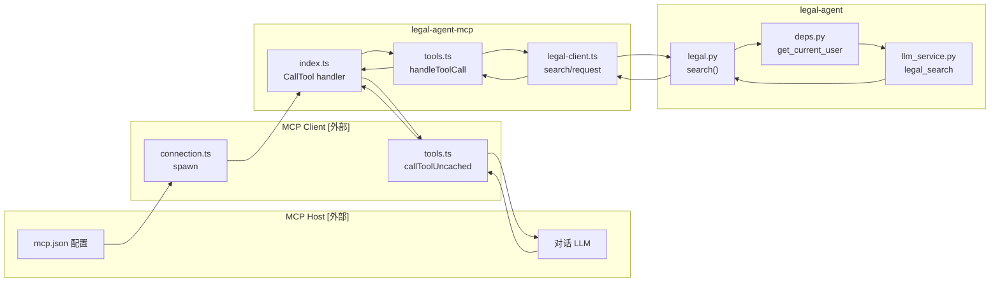

#### 1.2.3 legal-agent-mcp 内部三文件职责

| 文件 | 行号区间（约） | 入口 / 出口 | 核心函数 |
|------|----------------|-------------|----------|
| `src/index.ts` | 16–40 | stdio JSON-RPC ↔ `handleToolCall` | `main()` · `Server.setRequestHandler` · `StdioServerTransport.connect` |
| `src/tools.ts` | 6–98 | MCP 工具元数据 | `TOOL_DEFINITIONS`（供 `tools/list`） |
| `src/tools.ts` | 100–209 | 参数校验 + 业务分发 + 格式化 | `handleToolCall()` · `searchArgs` 等 Zod schema |
| `src/legal-client.ts` | 74–122 | JWT 生命周期 | `fromEnv()` · `ensureToken()` · `login()` |
| `src/legal-client.ts` | 124–146 | 通用 HTTP | `request()` — Bearer + 超时 + 错误解析 |
| `src/legal-client.ts` | 148–272 | 业务 API 封装 | `search()` · `chat()` · `draftContract()` · `reviewContractFile()` 等 |

**`index.ts` 是唯一 MCP 协议入口**，不包含业务逻辑：

```32:36:legal-agent-mcp/src/index.ts
  server.setRequestHandler(CallToolRequestSchema, async (request) => {
    const { name, arguments: args } = request.params
    const result = await handleToolCall(client, name, args ?? {})
    return result
  })
```

**`tools.ts` 是工具路由中心**（以 legal_search 为例）：

```137:147:legal-agent-mcp/src/tools.ts
      case 'legal_search': {
        const { query, search_type, optimize } = searchArgs.parse(args)
        const result = await client.search(query, search_type ?? 'comprehensive', optimize ?? false)
        return {
          content: [{
            type: 'text',
            text: `# 法律检索结果\n\n**类型**: ${result.search_type}\n\n${result.answer}\n\n${
              result.references.length ? `**参考**: ${result.references.join('；')}` : ''
            }`.trim(),
          }],
        }
```

**`legal-client.ts` 是 HTTP 出口**：

```148:150:legal-agent-mcp/src/legal-client.ts
  async search(query: string, searchType = 'comprehensive', optimize = false): Promise<SearchResult> {
    return this.request('POST', '/api/v1/search', { query, search_type: searchType, optimize })
  }
```

#### 1.2.4 工具级代码映射表

| MCP 工具 | tools.ts 分支 | legal-client 方法 | HTTP API | 后端路由 | 后端服务 |
|----------|---------------|-------------------|----------|----------|----------|
| `legal_search` | `case 'legal_search'` | `search()` | POST `/api/v1/search` | `legal.py::search` | `llm_service.legal_search` |
| `legal_chat` | `case 'legal_chat'` | `chat()` | POST `/api/v1/chat` | `legal.py::chat` | `llm_service.chat_reply` + ORM 会话 |
| `contract_draft` | `case 'contract_draft'` | `draftContract()` | POST `/api/v1/contract/draft` | `contract.py::create_draft` | `llm_service.draft_contract` |
| `contract_review_file` | `case 'contract_review_file'` | `reviewContractFile()` | POST upload + POST review | `contract.py::upload_contract` → `run_review` | `document_parser` + `llm_service.review_contract` |
| `contract_compare_files` | `case 'contract_compare_files'` | `compareContractFiles()` | POST `/api/v1/contract/compare` | `contract.py::compare_contract_files` | `document_parser` + `compare_service.compare_texts` |
| `legal_capabilities` | `case 'legal_capabilities'` | `getMetadata()` | GET `/api/v1/content/*` | `content.py` | `content_service` 静态数据 |

#### 1.2.5 复合调用链：contract_review_file

`contract_review_file` 在 MCP 层是一次 `tools/call`，但在 HTTP 层串行两次请求：

```
handleToolCall('contract_review_file')
  └─ legal-client.reviewContractFile(path, mode)
       ├─ uploadContract(path, mode)     → POST /api/v1/contract/upload  [multipart]
       │    └─ contract.py::upload_contract → document_parser.parse_file
       └─ runReview(uploaded.id)         → POST /api/v1/contract/review/{id}
            └─ contract.py::run_review → llm_service.review_contract
```

对应代码：

```213:216:legal-agent-mcp/src/legal-client.ts
  async reviewContractFile(filePath: string, reviewMode = 'checklist'): Promise<ContractReviewResult> {
    const uploaded = await this.uploadContract(filePath, reviewMode)
    return this.runReview(uploaded.id)
  }
```

#### 1.2.6 MCP SDK 边界（本仓库依赖）

| SDK 包 | 用途 | 调用位置 |
|--------|------|----------|
| `@modelcontextprotocol/sdk/server` | `Server` 类 | `index.ts` |
| `@modelcontextprotocol/sdk/server/stdio` | `StdioServerTransport` | `index.ts` |
| `@modelcontextprotocol/sdk/types` | `ListToolsRequestSchema` · `CallToolRequestSchema` | `index.ts` |
| `@modelcontextprotocol/sdk/client` [DSH] | `Client` 类 | `mcp-client/connection.ts` |

Server 端不直接使用 Client；Client 在 Host 应用内，通过 SDK 的 `client.request({ method: 'tools/call', ... })` 与 Server 通信。

#### 1.2.7 Host 侧参考实现（DeepSeek Harness）

Cursor/Codex 的 MCP Client 为闭源，本仓库以 DSH 的 `@deepseek-ai/dsh-mcp-client` 作为可读参考：

| 文件 | 函数 | 对应 MCP 步骤 |
|------|------|---------------|
| `mcp-client/src/connection.ts` | `startConnection()` | spawn MCP Server 子进程 |
| `mcp-client/src/transport.ts` | `createTransport()` | 创建 `StdioClientTransport` |
| `mcp-client/src/tools.ts` | `syncTools()` | `tools/list` + 注册到 `ctx.tools` |
| `mcp-client/src/tools.ts` | `callToolUncached()` | 发 `tools/call`，超时控制 |
| `packages/client/*` [外部] | ToolRuntime | LLM 调用工具时的执行入口 |

DSH 将 MCP 工具暴露为 `mcp__<serverName>__<rawName>`（如 `mcp__legal-agent__legal_search`），LLM 看到的是 Harness 命名后的 public name，wire 上仍发原始 `legal_search`。

#### 1.2.8 编译产物与运行时入口

| 阶段 | 路径 | 说明 |
|------|------|------|
| TypeScript 源码 | `src/*.ts` | 开发编辑 |
| 编译输出 | `dist/index.js` | `npm run build` → MCP 实际启动入口 |
| 启动命令 | `node dist/index.js` | Cursor `mcp.json` 中的 `args` |
| 环境变量 | `LEGAL_AGENT_URL` 等 | Host 通过 `env` 注入子进程 |

---

## 2. 总体分层架构

```
┌─────────────────────────────────────────────────────────────────┐
│ AI 客户端层                                                      │
│  Cursor · Codex CLI · DeepSeek Harness · 其他 MCP Host          │
└───────────────────────────────┬─────────────────────────────────┘
                                │ MCP (stdio JSON-RPC)
                                │  tools/list · tools/call
┌───────────────────────────────▼─────────────────────────────────┐
│ legal-agent-mcp（本仓库）                                        │
│  ┌─────────────┐  ┌─────────────┐  ┌─────────────────────────┐  │
│  │ index.ts    │  │ tools.ts    │  │ legal-client.ts         │  │
│  │ MCP Server  │→ │ 工具路由     │→ │ HTTP Client + JWT 管理  │  │
│  │ StdioTransport│ │ Zod 校验    │  │ FormData 文件上传       │  │
│  └─────────────┘  └─────────────┘  └────────────┬────────────┘  │
└───────────────────────────────────────────────────┼─────────────┘
                                                    │ HTTP/REST
                                                    │ Bearer JWT
┌───────────────────────────────────────────────────▼─────────────┐
│ legal-agent backend（FastAPI，:8010）                            │
│  ┌──────────┐ ┌──────────┐ ┌────────────┐ ┌──────────────────┐   │
│  │ auth     │ │ legal    │ │ contract   │ │ content          │   │
│  │ /login   │ │ /search  │ │ /upload    │ │ /search-types    │   │
│  │          │ │ /chat    │ │ /review    │ │ /draft-styles    │   │
│  └──────────┘ └──────────┘ │ /draft     │ └──────────────────┘   │
│                            │ /compare   │                         │
│                            └─────┬──────┘                         │
│  ┌───────────────────────────────▼─────────────────────────────┐ │
│  │ 服务层：llm_service · document_parser · compare_service · …  │ │
│  └───────────────────────────────┬─────────────────────────────┘ │
│  ┌───────────────────────────────▼─────────────────────────────┐ │
│  │ 基础设施：SQLite · 文件存储 · OpenAI API（可选）             │ │
│  └─────────────────────────────────────────────────────────────┘ │
└─────────────────────────────────────────────────────────────────┘
```

**请求链路（以 `legal_search` 为例）：**

```
用户自然语言
  → AI 客户端 LLM 决策调用 legal_search
  → MCP Host 发送 tools/call (stdio)
  → index.ts 接收 → tools.ts 校验参数
  → legal-client.ts POST /api/v1/search
  → Legal Agent llm_service.legal_search()
  → 返回 Markdown 文本 → MCP text content → LLM 整合回复
```

### 2.1 交互序列图

#### MCP Host 启动与工具发现

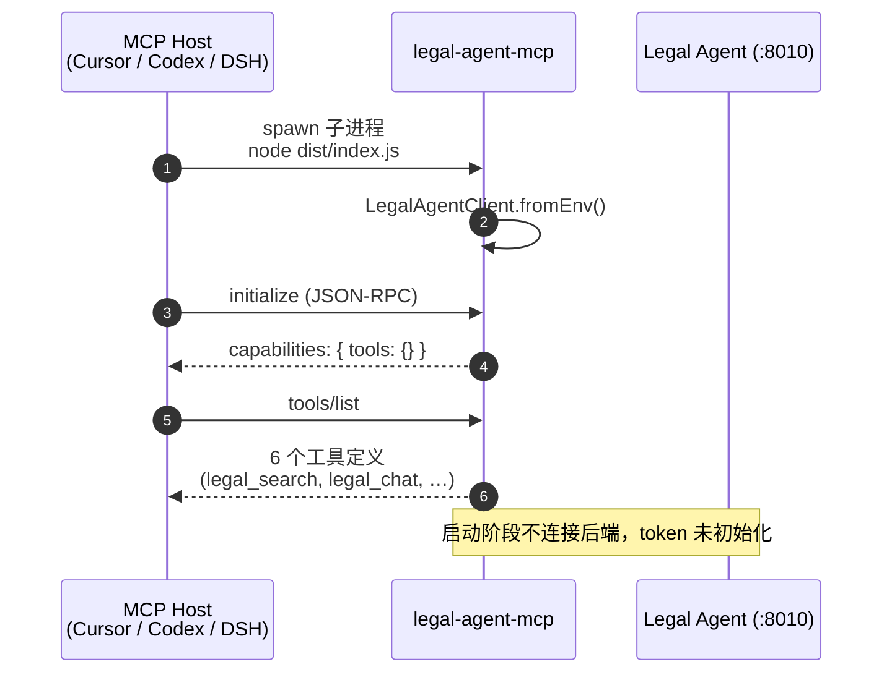

#### 通用工具调用（以 legal_search 为例）

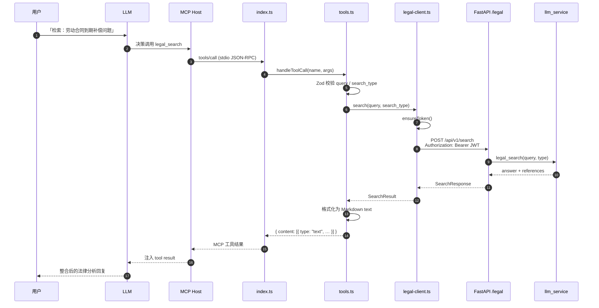

#### JWT 延迟认证

```mermaid
sequenceDiagram
    autonumber
    participant Tools as tools.ts
    participant Client as legal-client.ts
    participant Auth as auth API
    participant DB as SQLite

    Tools->>Client: 任意需鉴权 API
    Client->>Client: ensureToken()

    alt LEGAL_AGENT_TOKEN 已配置
        Client->>Client: 直接使用环境变量 token
    else 内存中已有 token
        Client->>Client: 返回缓存 token
    else 首次调用，并发安全
        Client->>Auth: POST /api/v1/auth/login<br/>{ username, password }
        Auth->>DB: authenticate_user()
        DB-->>Auth: User 记录
        Auth->>Auth: create_access_token(user.id)
        Auth-->>Client: { access_token }
        Client->>Client: 缓存 token（进程内存）
    end

    Client->>Client: 后续 request() 均附加<br/>Authorization: Bearer &lt;token&gt;
```

---

## 3. 本仓库模块结构

```
legal-agent-mcp/
├── src/
│   ├── index.ts          # MCP Server 入口，注册 ListTools / CallTool
│   ├── tools.ts          # 工具定义、Zod Schema、handleToolCall 路由
│   └── legal-client.ts   # Legal Agent HTTP 客户端、JWT 管理
├── dist/                 # tsc 编译输出（MCP 启动入口）
├── docs/
│   └── architecture.md   # 本文档
├── package.json
├── tsconfig.json
├── .env.example
└── README.md
```

### 3.1 `index.ts` — MCP Server 入口

职责：

1. 从环境变量构造 `LegalAgentClient`
2. 创建 MCP `Server`，声明 `tools` 能力
3. 注册 `ListToolsRequestSchema` → 返回 `TOOL_DEFINITIONS`
4. 注册 `CallToolRequestSchema` → 委托 `handleToolCall`
5. 通过 `StdioServerTransport` 与 Host 通信

```typescript
// 核心注册逻辑（简化）
server.setRequestHandler(ListToolsRequestSchema, async () => ({
  tools: TOOL_DEFINITIONS.map(({ name, description, inputSchema }) => ({
    name, description, inputSchema,
  })),
}))

server.setRequestHandler(CallToolRequestSchema, async (request) => {
  return handleToolCall(client, request.params.name, request.params.arguments ?? {})
})
```

### 3.2 `tools.ts` — 工具层

职责：

| 功能 | 说明 |
|------|------|
| 工具元数据 | `TOOL_DEFINITIONS`：name、description、JSON Schema inputSchema |
| 参数校验 | Zod schema（searchArgs、chatArgs 等） |
| 结果格式化 | 将 API 响应转为 MCP `text` content（Markdown） |
| 错误隔离 | catch 所有异常，返回 `isError: true` 的文本，避免进程崩溃 |

**设计选择：** inputSchema 使用 JSON Schema（MCP 规范），运行时校验使用 Zod（TypeScript 生态），二者字段保持一致。

### 3.3 `legal-client.ts` — HTTP 客户端

职责：

| 模块 | 说明 |
|------|------|
| 配置 | `LegalAgentConfig` / `fromEnv()` 读取环境变量 |
| 认证 | `ensureToken()` 延迟登录；支持 `LEGAL_AGENT_TOKEN` 直连或 username/password |
| JSON API | `request()` 统一封装 fetch + Bearer + 超时（180s） |
| 文件 API | `uploadContract` / `compareContractFiles` 使用 FormData + Blob |
| 复合流程 | `reviewContractFile` = upload + runReview 两步串行 |

**超时策略：**

- 登录：30s
- 一般 API / 文件操作：180s（LLM 生成与文档解析可能较慢）

---

## 4. MCP 工具 ↔ API 映射

| MCP 工具 | HTTP 方法 | API 路径 | 后端服务 |
|----------|-----------|----------|----------|
| `legal_search` | POST | `/api/v1/search` | `llm_service.legal_search` |
| `legal_chat` | POST | `/api/v1/chat` | `llm_service.chat_reply` + DB 会话 |
| `contract_draft` | POST | `/api/v1/contract/draft` | `llm_service.draft_contract` |
| `contract_review_file` | POST ×2 | `/api/v1/contract/upload` → `/review/{id}` | `document_parser` + `llm_service.review_contract` |
| `contract_compare_files` | POST | `/api/v1/contract/compare` | `document_parser` + `compare_service.compare_texts` |
| `legal_capabilities` | GET ×2 | `/api/v1/content/search-types`、`/draft-styles` | `content_service` |

### 4.1 工具参数详情

#### `legal_search`

```json
{
  "query": "string (required)",
  "search_type": "comprehensive | regulation | case | penalty | interpretation",
  "optimize": "boolean"
}
```

#### `legal_chat`

```json
{
  "message": "string (required)",
  "module": "labor_law | qa | financial | overseas",
  "session_id": "number (optional, 多轮对话)"
}
```

#### `contract_draft`

```json
{
  "purpose": "string (required)",
  "position": "string",
  "extra_info": "string",
  "style": "简明居中 | 详细严谨 | 偏向甲方 | 偏向乙方",
  "draft_type": "string"
}
```

#### `contract_review_file`

```json
{
  "file_path": "string (required, 本地路径)",
  "review_mode": "checklist | reference"
}
```

#### `contract_compare_files`

```json
{
  "left_file_path": "string (required)",
  "right_file_path": "string (required)"
}
```

---

## 5. 认证架构

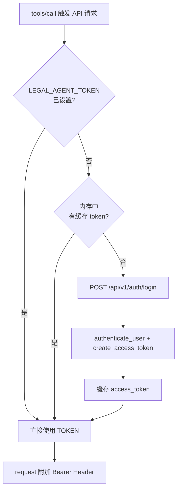

| 环境变量 | 优先级 | 说明 |
|----------|--------|------|
| `LEGAL_AGENT_TOKEN` | 最高 | 跳过登录，直接使用 JWT |
| `LEGAL_AGENT_USERNAME` + `LEGAL_AGENT_PASSWORD` | 次之 | 首次调用时自动登录 |
| 默认值 | 最低 | admin / admin123（开发环境） |

**注意：** Token 仅缓存在 MCP 进程内存中，进程重启后需重新登录或使用 TOKEN 环境变量。

---

## 6. 关键业务流程

### 6.1 合同审核（两步式）

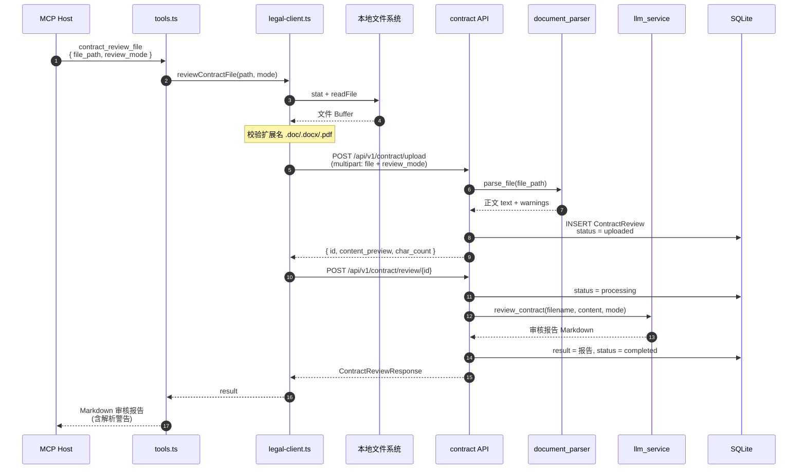

### 6.2 合同比对

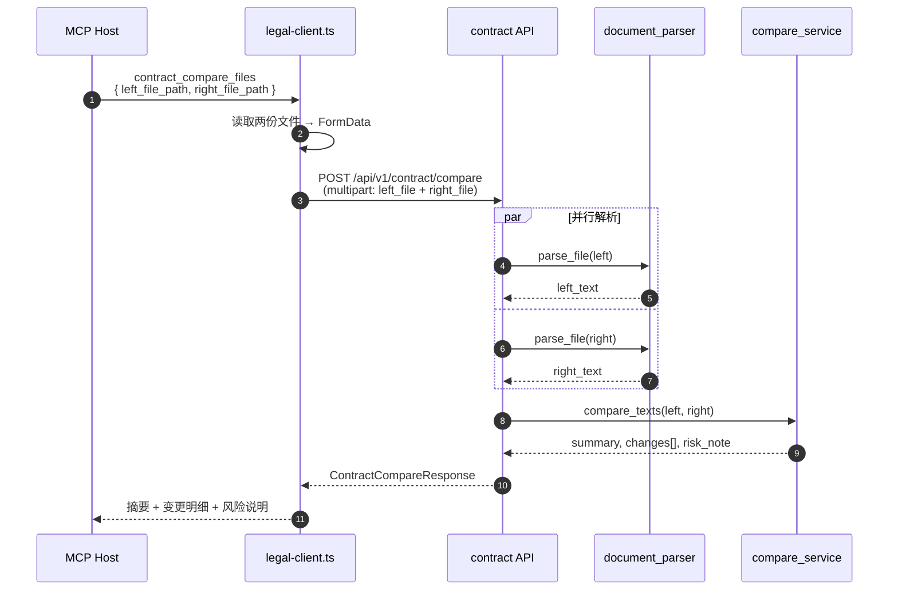

### 6.3 多轮法律问答

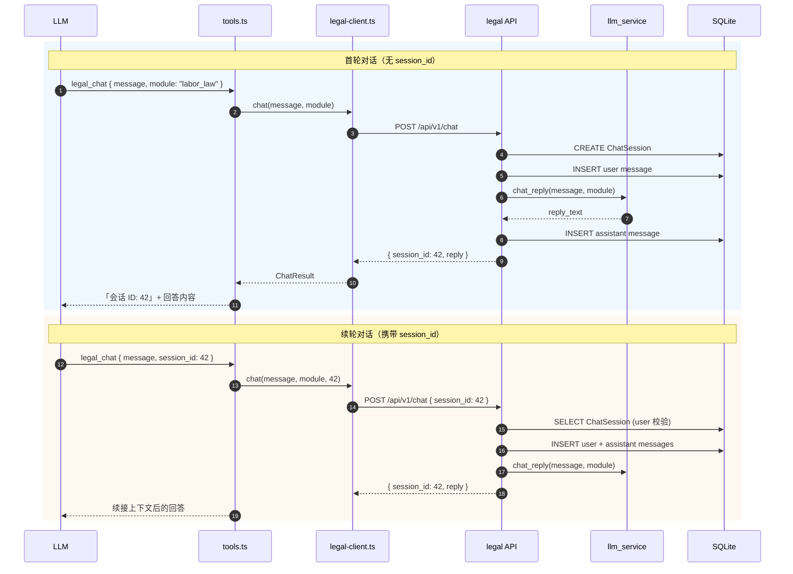

### 6.4 合同起草

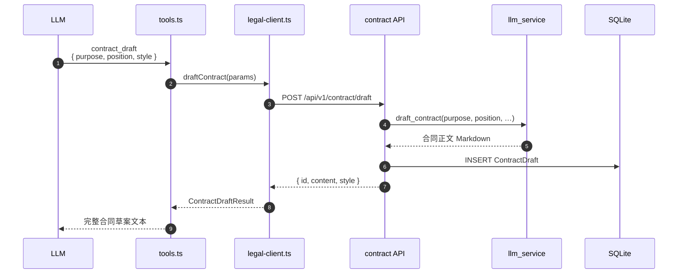

### 6.5 错误处理

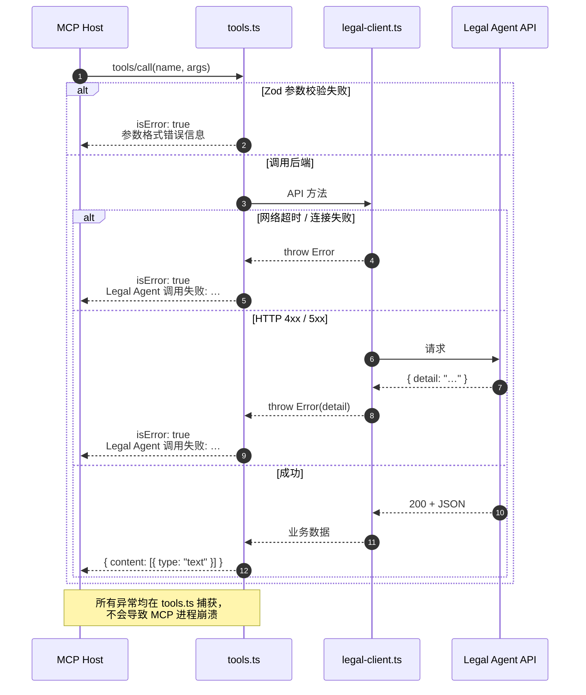

MCP 工具返回文本中包含 `会话 ID`（`legal_chat`），LLM 可在后续调用中传入 `session_id` 实现上下文延续。

---

## 7. Legal Agent 后端架构（依赖系统）

legal-agent-mcp 依赖的后端采用经典 FastAPI 分层：

```
legal-agent/backend/app/
├── main.py                 # FastAPI 入口、CORS、静态前端挂载
├── api/v1/
│   ├── auth.py             # JWT 登录
│   ├── legal.py            # 检索 / 问答
│   ├── contract.py         # 合同上传 / 审核 / 起草 / 比对
│   ├── content.py          # 元数据（检索类型、风格等）
│   ├── cms.py              # 合同库 CMS（MCP 未暴露）
│   ├── admin.py            # 系统管理
│   └── performance.py      # 履约管理
├── services/
│   ├── llm_service.py      # OpenAI 集成 + Mock 回退
│   ├── document_parser.py  # PDF/DOCX 解析
│   ├── compare_service.py  # 合同 diff + AI 风险说明
│   └── content_service.py  # 静态配置数据
├── models/                 # SQLAlchemy ORM
├── schemas/                # Pydantic 请求/响应模型
└── core/                   # 配置、数据库、安全
```

### 7.1 LLM 集成策略

`llm_service.py` 采用 **OpenAI API + Mock 回退**：

- 配置了 `OPENAI_API_KEY` → 调用真实模型生成检索/问答/审核/起草内容
- 未配置 → 返回结构化 Mock 文本，便于开发与演示

MCP 层对此透明，无需区分演示/生产模式。

### 7.2 文档解析

- 支持：`.doc`、`.docx`、`.pdf`
- PDF 扫描件：可选 OCR（`PARSER_OCR_ENABLED`）
- 单文件上限：100MB（`contract_max_upload_bytes`）

---

## 8. 客户端集成架构

### 8.1 Cursor

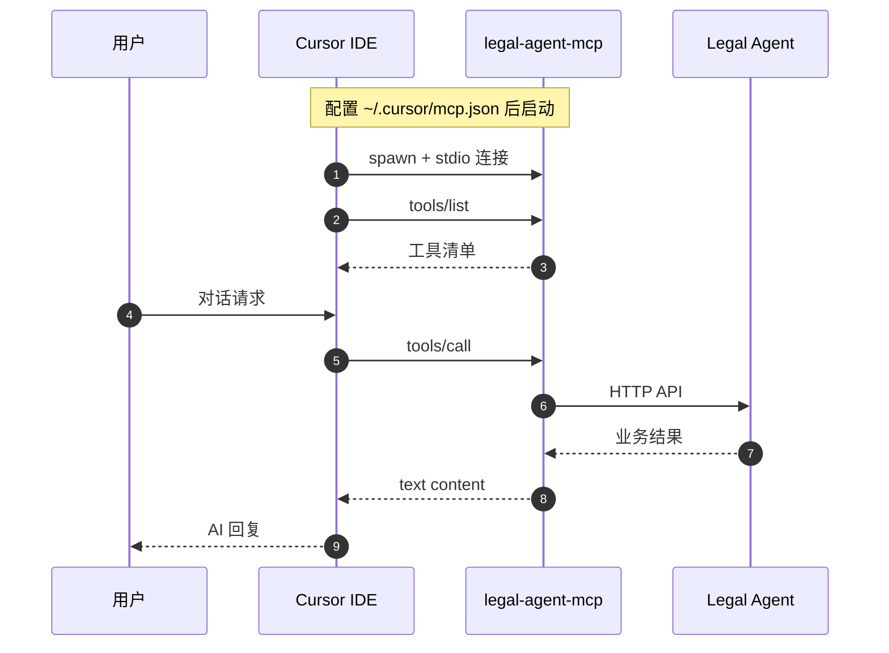

配置示例：

```
~/.cursor/mcp.json
  └─ mcpServers.legal-agent
       command: node
       args: ["/path/to/legal-agent-mcp/dist/index.js"]
       env: { LEGAL_AGENT_URL, LEGAL_AGENT_USERNAME, ... }
```

Cursor 作为 MCP Host，spawn 子进程，通过 stdin/stdout 与 MCP Server 通信。

### 8.2 Codex

```
~/.codex/config.toml
  [mcp_servers.legal-agent]
  command = "node"
  args = ["..."]
  [mcp_servers.legal-agent.env]
  LEGAL_AGENT_URL = "..."
```

Codex Core 的 MCP Client 在 Turn 执行期间按需调用工具，与 Shell/File 工具并列。

### 8.3 DeepSeek Harness

```yaml
# cordis.yml
mcp:
  servers:
    legal-agent:
      transport: stdio
      command: node
      args: [...]
      env: {...}
```

Harness MCP Client（`packages/mcp/mcp-client`）统一管理外部 MCP Server 生命周期。

---

## 9. 错误处理与可观测性

| 层级 | 策略 |
|------|------|
| MCP 工具层 | 所有异常捕获 → `{ content: [{ type: 'text', text: '...' }], isError: true }` |
| HTTP 客户端 | 解析 FastAPI `detail` 字段；超时由 `AbortSignal.timeout` 触发 |
| 参数校验 | Zod parse 失败 → 友好错误信息 |
| 进程级 | `main().catch()` → stderr 日志 + exit(1) |

**当前限制：**

- 无结构化日志 / metrics 输出
- 无请求 tracing ID
- Token 过期不会自动刷新（需重启 MCP 进程或预设 TOKEN）

---

## 10. 安全考量

| 风险 | 缓解措施 |
|------|----------|
| 凭据泄露 | 通过 MCP Host 的 `env` 注入，不硬编码；`.env` 已 gitignore |
| 文件路径访问 | MCP Server 可读取 Host 指定的本地路径；依赖 Host 沙箱策略 |
| JWT 传输 | 仅 localhost HTTP；生产环境应使用 HTTPS |
| 后端鉴权 | 除 content 部分接口外，业务 API 均需 Bearer Token |

---

## 11. 扩展指南

### 11.1 新增 MCP 工具

1. 在 `legal-client.ts` 添加对应 HTTP 方法
2. 在 `tools.ts` 的 `TOOL_DEFINITIONS` 注册工具元数据
3. 添加 Zod schema 与 `handleToolCall` 分支
4. 无需修改 `index.ts`（自动从 TOOL_DEFINITIONS 导出）

### 11.2 可扩展的后端 API（尚未 MCP 化）

| API | 说明 |
|-----|------|
| `GET /api/v1/chat/sessions` | 会话列表 |
| `GET /api/v1/contract/reviews` | 审核历史 |
| `GET /api/v1/contract/drafts` | 起草历史 |
| CMS / 履约 / 管理模块 | 企业扩展场景 |

### 11.3 传输方式扩展

当前仅 stdio。若需远程部署，可考虑：

- MCP Streamable HTTP（SDK 支持）
- 在 MCP Server 前加反向代理 + mTLS

---

## 12. 部署拓扑

### 开发环境（默认）

```
┌─────────────┐   stdio    ┌─────────────────┐   HTTP    ┌─────────────────┐
│   Cursor    │ ◄────────► │ legal-agent-mcp │ ◄───────► │ legal-agent     │
│  (本机)     │            │  (本机 Node)     │  :8010    │  (本机 uvicorn) │
└─────────────┘            └─────────────────┘           └─────────────────┘
```

### 生产环境（建议）

```
┌─────────────┐   stdio    ┌─────────────────┐   HTTPS   ┌─────────────────┐
│  AI Client  │ ◄────────► │ legal-agent-mcp │ ◄───────► │ legal-agent     │
│             │            │  (同机或容器)    │           │  (K8s / VM)     │
└─────────────┘            └─────────────────┘           └─────────────────┘
                                 env:
                                 LEGAL_AGENT_URL=https://legal-api.example.com
                                 LEGAL_AGENT_TOKEN=<service-account-jwt>
```

---

## 13. 技术栈汇总

| 组件 | 技术 |
|------|------|
| legal-agent-mcp | TypeScript, Node.js 20+, MCP SDK, Zod |
| legal-agent backend | Python 3.11+, FastAPI, SQLAlchemy, Pydantic |
| LLM | OpenAI API（可选） |
| 文档解析 | pypdf, python-docx, 可选 OCR |
| 数据库 | SQLite（默认） |
| 协议 | MCP over stdio + REST over HTTP |

---

## 14. 相关文档

- [README.md](../README.md) — 安装与配置指南
- [architecture.pptx](./architecture.pptx) — 架构分析 PPT（27 页）
- [generate_architecture_ppt.py](./generate_architecture_ppt.py) — PPT 生成脚本
- [Legal Agent 仓库](../../legal-agent/) — 后端源码
- [MCP 规范](https://modelcontextprotocol.io/)
- [Codex MCP 接口参考](../../codex/codex-rs/docs/codex_mcp_interface.md)
