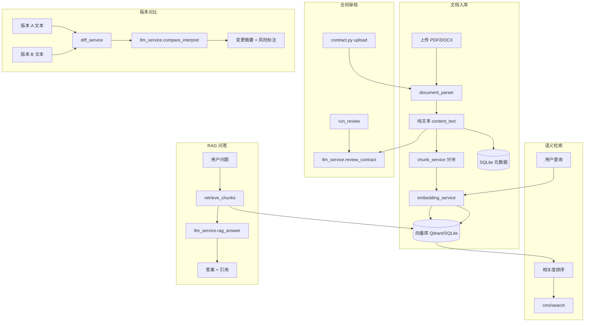
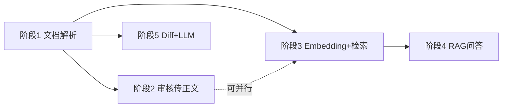

# Legal-Agent AI 能力改造方案

> 基于 `spec/算法模型实现说明.md` 与 `spec/合同管理系统-产品设计文档.md`，按五阶段顺序拆解具体改造方案与文件改动清单。  
> 版本：v1.0 | 日期：2026-06-16

---

## 一、改造目标与总体架构

### 1.1 目标

将 CMS 与合同审核模块从「Mock / 规则演示」升级为「文档解析 → 向量化索引 → RAG → Diff + LLM」的真实 AI 管线，同时保持：

- 未配置 API Key 时仍可降级到 Mock（与现有 `llm_service` 策略一致）
- 最小侵入：优先扩展现有 `backend/app/services/`，不推翻 FastAPI + SQLite 架构
- 每阶段可独立交付、可验收

### 1.2 目标架构（改造完成后）



### 1.3 技术选型建议（MVP → 生产）

| 能力 | MVP（第 1–3 阶段） | 生产扩展 |
|------|-------------------|----------|
| PDF 解析 | `pypdf` | `pdfplumber`（表格） |
| DOCX 解析 | `python-docx` | 同上 |
| OCR（扫描件） | 暂不实现，返回明确错误提示 | PaddleOCR / 多模态 API |
| Embedding | OpenAI 兼容 `/embeddings` | 同左或本地 bge-m3 |
| 向量库 | **Qdrant 本地嵌入式**（单文件，零运维） | Qdrant / Milvus 集群 |
| 关键词检索 | SQLite `LIKE` + 分块全文 | Elasticsearch |
| Diff | Python `difflib` + 条款分段 | 同上 |
| LLM | 现有 `httpx` + OpenAI 兼容 API | 同左 |

> **为何选 Qdrant 嵌入式**：项目当前用 SQLite，引入独立 Milvus 集群过重；Qdrant 支持 `path=` 本地持久化，与单机部署匹配，后续可无缝切远程服务。

---

## 二、阶段划分与依赖关系



| 阶段 | 名称 | 预估工时 | 前置依赖 |
|------|------|----------|----------|
| **1** | 文档解析（PDF/DOCX） | 3–5 人日 | 无 |
| **2** | 合同审核传入正文 | 1–2 人日 | 阶段 1 |
| **3** | Embedding + 向量检索 | 5–7 人日 | 阶段 1 |
| **4** | RAG 问答 | 4–6 人日 | 阶段 1、3 |
| **5** | 版本 Diff + LLM 解读 | 4–5 人日 | 阶段 1 |

**合计**：约 17–25 人日（1 人约 3.5–5 周）

---

## 三、阶段 1：文档解析（PDF/DOCX）

### 3.1 目标

- 上传 PDF/DOCX 后提取纯文本，写入 `content_text` 或审核记录
- 合同导入 `process_import()` 基于真实文本做字段抽取（先规则/LLM，替换硬编码）
- 解析失败时返回可读错误，不 silent fail

### 3.2 新增文件

| 文件 | 职责 |
|------|------|
| `backend/app/services/document_parser.py` | 统一解析入口：`parse_file(path) -> ParsedDocument` |
| `backend/app/services/document_parser_pdf.py` | PDF 文本提取（`pypdf`） |
| `backend/app/services/document_parser_docx.py` | DOCX 段落/表格提取（`python-docx`） |
| `backend/app/schemas/document_schemas.py` | `ParsedDocument(text, page_count, warnings, source_type)` |
| `backend/tests/test_document_parser.py` | 单元测试（样例 PDF/DOCX fixture） |

### 3.3 修改文件

| 文件 | 改动要点 |
|------|----------|
| `backend/requirements.txt` | 增加 `pypdf>=4.0`, `python-docx>=1.1` |
| `backend/app/core/config.py` | 增加 `parser_max_pages: int = 200`、`parser_ocr_enabled: bool = False` |
| `backend/app/api/v1/contract.py` | `upload` 后立即解析，将文本存 `ContractReview` 新字段 |
| `backend/app/models/models.py` | `ContractReview` 增加 `content_text: Text`、`parse_status: String` |
| `backend/app/services/cms_service.py` | `process_import()` 调用 `document_parser` + LLM/规则抽取 |
| `backend/app/api/v1/cms.py` | 导入接口返回解析进度与 warnings |
| `backend/app/schemas/schemas.py` | `ContractReviewResponse` 增加 `content_preview`（可选，前 500 字） |
| `backend/app/schemas/cms_schemas.py` | `ImportTaskResponse` 增加 `parse_warnings: list[str]` |
| `backend/.env.example` | 文档解析相关配置说明 |

### 3.4 核心接口设计

```python
# document_parser.py
@dataclass
class ParsedDocument:
    text: str
    source_type: Literal["pdf", "docx", "doc", "unknown"]
    page_count: int | None
    char_count: int
    warnings: list[str]  # 如「第3页无文本，可能为扫描件」

async def parse_file(file_path: str | Path) -> ParsedDocument:
    """按扩展名路由到 PDF/DOCX 解析器；扫描 PDF 无文本时 warnings 提示需 OCR。"""
```

### 3.5 验收标准

- [ ] 上传 `.pdf` / `.docx` 能提取正文，`char_count > 0`
- [ ] 扫描版 PDF（无文字层）返回 warning，不崩溃
- [ ] CMS 导入任务 `extracted_json` 字段来自真实解析（LLM 或正则辅助），非硬编码
- [ ] 已有 `.doc` 格式：MVP 可提示「请转为 docx」，或后续加 `antiword`/LibreOffice 转换

### 3.6 前端改动（可选，本阶段最小）

| 文件 | 改动 |
|------|------|
| `frontend/src/views/ContractReviewView.vue` | 上传成功后展示「已解析 N 字」 |
| `frontend/src/views/cms/CmsImportView.vue` | 展示 `parse_warnings` |

---

## 四、阶段 2：合同审核传入正文

### 4.1 目标

- `review_contract()` 接收完整合同正文（或截断后的摘要+全文片段）
- 支持 `checklist` / `reference` 两种 `review_mode` 差异化 prompt
- 超长合同分块审核再合并（> 模型上下文时）

### 4.2 修改文件

| 文件 | 改动要点 |
|------|----------|
| `backend/app/services/llm_service.py` | `review_contract(filename, content_text, review_mode)` 重写 prompt；超长时分块 |
| `backend/app/api/v1/contract.py` | `run_review` 从 DB 读 `content_text`，传入 `review_contract` |
| `backend/app/services/document_parser.py` | 若 upload 未解析，review 时补解析 |
| `backend/app/core/config.py` | `review_max_chars: int = 80000`、`review_chunk_size: int = 12000` |

### 4.3 新增文件

| 文件 | 职责 |
|------|------|
| `backend/app/services/text_chunker.py` | 按条款/段落分块，供审核与 RAG 复用 |

```python
# text_chunker.py — 与阶段 3、4 共用
def chunk_contract_text(text: str, chunk_size: int = 800, overlap: int = 100) -> list[TextChunk]:
    """
    优先按「第X条」切分；无法识别时按段落+滑动窗口。
    TextChunk: content, section_title, start_offset, index
    """
```

### 4.4 Prompt 改造要点

```python
# llm_service.py — review_contract 示例
system = """你是一名资深合同审核律师。请基于提供的合同全文，从以下维度审核：
主体资质、权利义务、付款/交付、违约责任、保密、知识产权、争议解决、合规风险。
输出 Markdown：摘要、分项意见、风险等级(高/中/低)、修改建议。"""

user = f"文件名：{filename}\n审核模式：{review_mode}\n\n合同正文：\n{content_text[:review_max_chars]}"
```

### 4.5 验收标准

- [ ] 配置 API Key 后，审核报告内容与上传合同相关（非仅文件名模板）
- [ ] 未配置 Key 时仍走 `_mock_contract_review`
- [ ] 10 页以内 PDF 审核端到端 < 120s（取决于模型）
- [ ] `ContractReview.content_text` 持久化，可重复审核

### 4.6 前端改动

| 文件 | 改动 |
|------|------|
| `frontend/src/views/ContractReviewView.vue` | 审核前展示正文预览；支持重新审核 |
| `frontend/src/api/legal.ts` | 类型增加 `content_preview` 字段 |

---

## 五、阶段 3：Embedding + 向量检索

### 5.1 目标

- 合同入库/更新时自动分块并向量化
- CMS 搜索 `mode=semantic` 走向量相似度，替代假相关度
- 保留 `mode=keyword` 的 SQL 检索作为降级/混合检索一路

### 5.2 数据模型新增

**新表 `contract_chunks`**（`backend/app/models/cms_models.py` 或独立 `vector_models.py`）：

```python
class ContractChunk(Base):
    __tablename__ = "contract_chunks"

    id: Mapped[int] = mapped_column(Integer, primary_key=True)
    contract_id: Mapped[int] = mapped_column(ForeignKey("managed_contracts.id"), index=True)
    version_id: Mapped[int | None] = mapped_column(ForeignKey("contract_versions.id"), nullable=True)
    chunk_index: Mapped[int] = mapped_column(Integer)
    section_title: Mapped[str] = mapped_column(String(256), default="")
    content: Mapped[str] = mapped_column(Text)
    start_offset: Mapped[int] = mapped_column(Integer, default=0)
    vector_id: Mapped[str] = mapped_column(String(64), index=True)  # Qdrant point id
    created_at: Mapped[datetime] = mapped_column(DateTime(timezone=True), default=utcnow)
```

**ManagedContract 可选字段**：`indexed_at: DateTime`、`index_status: String`

### 5.3 新增文件

| 文件 | 职责 |
|------|------|
| `backend/app/services/embedding_service.py` | `_call_embeddings(texts) -> list[list[float]]`，OpenAI 兼容 API |
| `backend/app/services/vector_store.py` | Qdrant 封装：`upsert`、`search`、`delete_by_contract` |
| `backend/app/services/index_service.py` | `index_contract(contract_id)`：分块 → embed → 写 DB + Qdrant |
| `backend/app/services/text_chunker.py` | 阶段 2 已建，本阶段正式接入 |
| `backend/scripts/reindex_all.py` | 全量重建索引（运维脚本） |

### 5.4 修改文件

| 文件 | 改动要点 |
|------|----------|
| `backend/requirements.txt` | 增加 `qdrant-client>=1.9` |
| `backend/app/core/config.py` | `embedding_model`、`qdrant_path`、`embedding_batch_size` |
| `backend/.env.example` | 增加 `EMBEDDING_MODEL=text-embedding-3-small`、`QDRANT_PATH=./data/qdrant` |
| `backend/app/services/cms_service.py` | `search_contracts()` semantic 模式调用 `vector_store.search` |
| `backend/app/services/cms_service.py` | `create_contract` / `confirm_import` / 更新正文后触发 `index_service.index_contract` |
| `backend/app/services/bootstrap.py` | 启动时 seed 数据完成后异步索引（或 lazy index） |
| `backend/app/schemas/cms_schemas.py` | `SearchResultItem` 的 `highlight` 来自 chunk 命中片段 |

### 5.5 配置项

```env
# .env 新增
EMBEDDING_MODEL=text-embedding-3-small
QDRANT_PATH=./data/qdrant
EMBEDDING_BATCH_SIZE=32
SEMANTIC_SEARCH_TOP_K=20
```

### 5.6 检索流程

```python
async def search_contracts_semantic(db, user_id, q: str) -> dict:
    query_vec = await embedding_service.embed_query(q)
    hits = await vector_store.search(
        vector=query_vec,
        filter={"user_id": user_id},
        top_k=settings.semantic_search_top_k,
    )
    # 按 contract_id 聚合最高分 chunk，去重排序
    # 混合检索（可选）：semantic_score * 0.7 + keyword_score * 0.3
```

### 5.7 验收标准

- [ ] 新建/导入合同后，`contract_chunks` 有记录，Qdrant collection 有向量
- [ ] 搜索「保密义务」能命中含保密条款的合同（非仅 tags 匹配）
- [ ] `mode=keyword` 行为与改造前 SQL 检索一致
- [ ] 删除合同时同步删除向量点
- [ ] 无 Embedding API Key 时 semantic 模式降级为 keyword + 提示

### 5.8 前端改动

| 文件 | 改动 |
|------|------|
| `frontend/src/views/cms/CmsSearchView.vue` | 语义/关键词切换；展示真实相关度与 chunk 高亮 |
| `frontend/src/api/cms.ts` | 搜索参数 `mode` 已有，确认响应字段对齐 |

---

## 六、阶段 4：RAG 问答

### 6.1 目标

- 替换 `answer_contract_qa()` 关键词字典
- 单合同问答：retrieve top-k chunks → LLM 生成答案 + 引用条款
- 支持多轮追问（可选：复用 `ChatSession` 或 CMS 专用 session 表）

### 6.2 新增文件

| 文件 | 职责 |
|------|------|
| `backend/app/services/rag_service.py` | `answer_contract_question(contract_id, question, history?)` |
| `backend/app/services/retrieval_service.py` | 向量检索 + 可选 BM25（SQLite FTS5）+ 融合 |
| `backend/app/prompts/rag_contract_qa.txt` | RAG system prompt 模板（要求引用条款、标注不确定） |

### 6.3 修改文件

| 文件 | 改动要点 |
|------|----------|
| `backend/app/services/llm_service.py` | 新增 `rag_answer(system, context_chunks, question)` |
| `backend/app/services/cms_service.py` | `answer_contract_qa` 委托 `rag_service`；保留关键词 fallback |
| `backend/app/api/v1/cms.py` | QA 响应增加 `citations: [{section, excerpt, chunk_id}]` |
| `backend/app/schemas/cms_schemas.py` | `ContractQaResponse` 扩展 citation 结构 |
| `backend/app/core/database.py` | 可选：启用 SQLite FTS5 虚拟表 `contract_chunks_fts` |

### 6.4 RAG Prompt 结构

```python
system = """你是合同问答助手。仅根据提供的合同条款片段回答，不得编造。
若片段不足以回答，明确说明。回答末尾用 [引用: 条款标题] 标注来源。"""

user = f"""合同名称：{contract.name}

相关条款：
{format_chunks(chunks)}

用户问题：{question}
"""
```

### 6.5 可选：多轮对话

**新表 `contract_qa_sessions`**（轻量）：

```python
class ContractQaSession(Base):
    contract_id: int
    user_id: int
    messages_json: str  # [{role, content}]
```

或复用现有 `ChatSession`，`module="contract_qa_{contract_id}"`。

### 6.6 验收标准

- [ ] 「违约金是多少」类问题返回答案且 `citations` 含对应 chunk
- [ ] 问题与合同无关时 LLM 回答「未在合同中找到」
- [ ] 无 API Key 时降级到原 `QA_ANSWERS` 关键词逻辑
- [ ] 响应时间 P95 < 15s（top_k=5，gpt-4o-mini 量级）

### 6.7 前端改动

| 文件 | 改动 |
|------|------|
| `frontend/src/views/cms/CmsDetailView.vue` | 问答面板展示引用跳转、置信度 |
| `frontend/src/components/ChatPanel.vue` | 支持 citation 点击滚动到条款（若详情页有正文锚点） |
| `frontend/src/api/cms.ts` | 更新 `ContractQaResponse` 类型 |

---

## 七、阶段 5：版本 Diff + LLM 解读

### 7.1 目标

- `compare_versions()` 对两版本 `content` 做真实 diff
- LLM 生成变更摘要、语义标注（责任主体变更、风险升降）
- 前端并排对比展示增删改

### 7.2 新增文件

| 文件 | 职责 |
|------|------|
| `backend/app/services/diff_service.py` | 条款级 diff + 行级 diff（`difflib.SequenceMatcher`） |
| `backend/app/services/compare_service.py` | 编排：diff → LLM 解读 → 结构化 `CompareResponse` |
| `backend/app/schemas/compare_schemas.py` | `DiffChange`, `CompareSummary`, `SemanticNote` |

### 7.3 修改文件

| 文件 | 改动要点 |
|------|----------|
| `backend/app/services/cms_service.py` | `compare_versions` 改为调用 `compare_service` |
| `backend/app/services/llm_service.py` | 新增 `interpret_diff(changes: list[DiffChange]) -> str` |
| `backend/app/api/v1/cms.py` | 对比 API 无 breaking change，响应字段更丰富 |
| `backend/app/schemas/cms_schemas.py` | `CompareChangeItem` 增加 `change_type: added|removed|modified`、行号 |

### 7.4 Diff 算法策略

```python
def diff_contract_versions(left: str, right: str) -> list[DiffChange]:
    """
    1. 按「第X条」或空行拆分为条款列表
    2. 条款级：匹配相同标题 → 内部做 SequenceMatcher
    3. 未匹配条款 → added/removed
    4. 输出统一 DiffChange 结构供 LLM 与前端使用
    """
```

### 7.5 LLM 解读 Prompt

```python
system = """你是合同法务专家。根据以下版本差异列表，输出：
1. 变更摘要（条数统计）
2. 每条变更的语义说明（如「付款触发条件变更」）
3. 风险变更预警（对甲方/乙方影响）
使用 JSON 格式。"""

user = json.dumps(changes, ensure_ascii=False)
```

### 7.6 验收标准

- [ ] 对比 v1.0 / v1.1 种子版本，diff 结果与 `VERSION_V10` / `VERSION_V11` 差异一致
- [ ] `ai_note` 由 LLM 生成（有 Key）或规则模板（无 Key）
- [ ] 前端 `CmsCompareView` 展示红/绿 diff 高亮
- [ ] 大版本（>5 万字）diff 在 3s 内完成（不含 LLM）

### 7.7 前端改动

| 文件 | 改动 |
|------|------|
| `frontend/src/views/cms/CmsCompareView.vue` | 并排 diff UI、AI 变更摘要卡片 |
| `frontend/src/views/ContractCompareView.vue` | 若复用合同审核模块，同步 diff 组件 |
| `frontend/src/components/ContractDiffPanel.vue` | **新建** 可复用 diff 展示组件 |

---

## 八、横切关注点

### 8.1 配置汇总（`.env` 完整示例）

```env
# 已有
OPENAI_API_KEY=sk-xxx
OPENAI_BASE_URL=https://api.openai.com/v1
OPENAI_MODEL=gpt-4o-mini

# 阶段 1–2
PARSER_MAX_PAGES=200

# 阶段 3–4
EMBEDDING_MODEL=text-embedding-3-small
QDRANT_PATH=./data/qdrant
EMBEDDING_BATCH_SIZE=32
SEMANTIC_SEARCH_TOP_K=20
RAG_TOP_K=5
RAG_MAX_CONTEXT_CHARS=6000

# 阶段 2、5
REVIEW_MAX_CHARS=80000
REVIEW_CHUNK_SIZE=12000
```

### 8.2 依赖汇总（`requirements.txt` 增量）

```text
pypdf>=4.0
python-docx>=1.1
qdrant-client>=1.9
```

可选后续：`pdfplumber`、`rank-bm25`、`sqlite-fts`（FTS5 已内置于 SQLite）

### 8.3 异步任务

解析、索引、审核耗时长，建议：

| 方案 | 适用 |
|------|------|
| **MVP**：FastAPI `BackgroundTasks` | 导入后立即返回，轮询 `import/{task_id}` |
| **V2**：Celery + Redis | 批量导入、全量 reindex |

改动：`cms.py` 的 `process_import` 改为 `status=processing` → 后台解析+索引 → `completed`。

### 8.4 错误处理与降级矩阵

| 场景 | 行为 |
|------|------|
| 无 OPENAI_API_KEY | LLM 功能走 Mock；Embedding 不可用则 semantic/RAG 降级 keyword |
| PDF 无文本层 | 返回 warning，提示 OCR 未启用 |
| 向量库不可用 | semantic 搜索降级 SQL；RAG 降级关键词 QA |
| 合同未索引 | 问答前 lazy index；超时则提示「正在建立索引」 |

### 8.5 测试策略

| 类型 | 内容 |
|------|------|
| 单元测试 | `document_parser`、`text_chunker`、`diff_service` |
| 集成测试 | upload → parse → index → search → qa 全链路（mock embedding API） |
| 样例文件 | `backend/tests/fixtures/sample.pdf`、`sample.docx` |

---

## 九、文件改动清单（汇总）

### 9.1 新建文件（18 个）

```
backend/app/services/document_parser.py
backend/app/services/document_parser_pdf.py
backend/app/services/document_parser_docx.py
backend/app/services/text_chunker.py
backend/app/services/embedding_service.py
backend/app/services/vector_store.py
backend/app/services/index_service.py
backend/app/services/retrieval_service.py
backend/app/services/rag_service.py
backend/app/services/diff_service.py
backend/app/services/compare_service.py
backend/app/schemas/document_schemas.py
backend/app/schemas/compare_schemas.py
backend/app/prompts/rag_contract_qa.txt
backend/scripts/reindex_all.py
backend/tests/test_document_parser.py
backend/tests/test_diff_service.py
frontend/src/components/ContractDiffPanel.vue
```

### 9.2 修改文件（后端 16 个）

```
backend/requirements.txt
backend/.env.example
backend/app/core/config.py
backend/app/core/database.py
backend/app/models/models.py
backend/app/models/cms_models.py
backend/app/services/llm_service.py
backend/app/services/cms_service.py
backend/app/services/bootstrap.py
backend/app/api/v1/contract.py
backend/app/api/v1/cms.py
backend/app/schemas/schemas.py
backend/app/schemas/cms_schemas.py
```

### 9.3 修改文件（前端 7 个）

```
frontend/src/api/legal.ts
frontend/src/api/cms.ts
frontend/src/views/ContractReviewView.vue
frontend/src/views/cms/CmsImportView.vue
frontend/src/views/cms/CmsSearchView.vue
frontend/src/views/cms/CmsDetailView.vue
frontend/src/views/cms/CmsCompareView.vue
```

---

## 十、实施顺序与里程碑

| 里程碑 | 交付物 | 可演示能力 |
|--------|--------|------------|
| **M1** | 阶段 1 完成 | 上传 PDF/DOCX 看到正文；导入字段来自真实文本 |
| **M2** | 阶段 2 完成 | 合同审核报告基于正文 |
| **M3** | 阶段 3 完成 | 语义搜索命中条款片段 |
| **M4** | 阶段 4 完成 | 合同详情页 RAG 问答带引用 |
| **M5** | 阶段 5 完成 | 版本对比真实 diff + AI 摘要 |

### 建议排期（1 名后端 + 0.5 名前端）

| 周次 | 任务 |
|------|------|
| W1 | 阶段 1 + 阶段 2 |
| W2 | 阶段 3（向量库接入、索引 pipeline） |
| W3 | 阶段 4（RAG）+ 前端问答/搜索 |
| W4 | 阶段 5（Diff + LLM）+ 集成测试 + 文档更新 |
| W5 | 缓冲：OCR 预研、性能优化、reindex 脚本 |

---

## 十一、与产品文档的对应关系

| 产品文档能力 | 本方案阶段 | 备注 |
|-------------|-----------|------|
| 2.2 合同导入与 OCR | 阶段 1 | OCR 列为 V2，MVP 仅文本层 PDF |
| 2.4 精确检索 / 语义检索 | 阶段 3 | ES 混合检索可后续加 |
| 2.5 AI 合同问答 (RAG) | 阶段 4 | 含引用与置信度 |
| 2.7 版本对比 + AI 增强 | 阶段 5 | difflib + LLM |
| 3.2 数据处理管道 | 阶段 1→3 | 分块+向量化在 index_service |
| 合同审核（非法务 Agent 模块） | 阶段 2 | `contract.py` 链路 |

---

## 十二、风险与待决事项

| 项 | 说明 | 建议 |
|----|------|------|
| 扫描件 PDF | 无 OCR 无法提取文字 | 阶段 1 明确提示；V2 接 PaddleOCR 或多模态 API |
| 上下文长度 | 长合同超 token 限制 | 分块审核 + RAG 只送 top-k |
| Embedding 成本 | 全库 reindex 消耗 | 增量索引 + `indexed_at` 脏标记 |
| SQLite 并发 | 向量检索走 Qdrant，影响小 | 生产可迁 PostgreSQL |
| `.doc` 旧格式 | python-docx 不支持 | 提示转 docx 或 LibreOffice headless 转换 |

---

## 十三、下一步行动

1. **确认技术选型**：Qdrant 本地 vs Chroma；Embedding 模型是否与 Chat 同厂商
2. **从阶段 1 开工**：新建 `document_parser.py`，改 `contract.py` upload 链路
3. **准备测试合同样本**：2 份 PDF + 2 份 DOCX（含扫描件负例）
4. **更新** `spec/算法模型实现说明.md`：每阶段完成后标记「已落地」状态

如需直接进入编码，建议从 **阶段 1 + 阶段 2** 合并 PR 开始（改动面小、可快速看到审核效果）。
