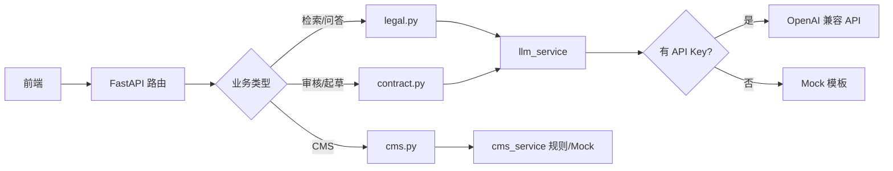

# Legal-Agent 算法模型实现说明

> 本文档描述 legal-agent 项目中算法/模型相关能力的当前实现方式，以及与设计文档的差距。

## 总体结论

当前项目**没有自研或本地部署的算法模型**，也**没有 RAG、向量检索、OCR、NER、Diff 等独立算法模块**。实现分两层：

1. **真正调用大模型**：集中在 `backend/app/services/llm_service.py`，通过 OpenAI 兼容 API 做 Prompt 工程。
2. **合同管理系统（CMS）里的「AI」能力**：多数是**规则、模板、硬编码演示数据**，用于 UI 联调，尚未接入真实模型。

产品文档（`spec/合同管理系统-产品设计文档.md`）里规划的 Embedding、Milvus、RAG、OCR 等，**目前都未落地**。

---

## 1. 核心 LLM 集成（唯一真实模型调用）

### 调用方式

统一入口是 `_call_llm()`：用 `httpx` 调 `/chat/completions`，兼容 OpenAI 及同类 API（如千问、DeepSeek 等）。

```python
async def _call_llm(system: str, user: str) -> str | None:
    settings = get_settings()
    if not settings.openai_api_key.strip():
        return None
    url = f"{settings.openai_base_url.rstrip('/')}/chat/completions"
    headers = {
        "Authorization": f"Bearer {settings.openai_api_key}",
        "Content-Type": "application/json",
    }
    payload = {
        "model": settings.openai_model,
        "messages": [
            {"role": "system", "content": system},
            {"role": "user", "content": user},
        ],
        "temperature": 0.3,
    }
    async with httpx.AsyncClient(timeout=120.0) as client:
        resp = await client.post(url, headers=headers, json=payload)
        resp.raise_for_status()
        data = resp.json()
        return data["choices"][0]["message"]["content"]
```

**源码位置**：`backend/app/services/llm_service.py`

### 配置

在 `backend/.env` 中配置（默认模型 `gpt-4o-mini`）：

```python
openai_api_key: str = ""
openai_base_url: str = "https://api.openai.com/v1"
openai_model: str = "gpt-4o-mini"
```

**源码位置**：`backend/app/core/config.py`

### 演示模式（Mock Fallback）

未配置 `OPENAI_API_KEY` 时，`_call_llm` 返回 `None`，各业务函数回退到 `_mock_*` 模板文本，保证前端可用。

### 各业务如何用 Prompt 区分场景

| 功能 | 实现函数 | 策略 |
|------|----------|------|
| 法律检索 | `legal_search()` | 按 `search_type` 选不同 system prompt（综合分析/法规/类案等） |
| 智能问答 | `chat_reply()` | 按 `module` 选 prompt（劳动法/金融/出海等） |
| 合同起草 | `draft_contract()` | 完整合同 vs 单条款，不同 system + user 拼接 |
| 合同审核 | `review_contract()` | 固定审核维度 prompt，输出 Markdown 报告 |

**Prompt 定义示例**（`llm_service.py`）：

```python
SEARCH_PROMPTS = {
    "comprehensive": "你是一名资深法律顾问，请对以下法律问题进行综合分析，给出结论、法律依据与实务建议：",
    "regulation": "你是一名法规检索专家，请检索并解读与以下问题相关的法律法规条文：",
    "case": "你是一名类案检索专家，请分析以下问题相关的司法裁判观点与类案：",
    "penalty": "你是一名行政处罚领域专家，请分析以下问题涉及的行政处罚规定与案例：",
    "interpretation": "你是一名法律专业解读专家，请对以下问题进行深度专业解读：",
}

MODULE_PROMPTS = {
    "labor_law": "你是一名劳动法专家，请基于中国劳动法律法规，准确、专业地回答用户问题，并在回答末尾列出主要法律依据：",
    "qa": "你是一名企业法务顾问，请专业、清晰地回答以下法律问题：",
    "financial": "你是一名金融合规专家，请从合规角度回答以下问题：",
    "overseas": "你是一名企业出海法务专家，请结合跨境合规要求回答以下问题：",
}
```

**注意**：

- 检索的 `references` 是写死的固定法条列表，**不是**真实检索结果。
- 合同审核目前**只传文件名**，不读上传文件内容（`contract.py` 中 `review_contract(record.filename)`）。

---

## 2. 调用链路（API → Service → LLM）



### API 路由映射

| 功能 | 路由 | 服务函数 |
|------|------|----------|
| 法律检索 | `POST /api/v1/search` | `legal_search()` |
| 智能问答 | `POST /api/v1/chat` | `chat_reply()`（会话存 SQLite） |
| 合同审核 | `POST /api/v1/contract/review/{id}` | `review_contract()` |
| 合同起草 | `POST /api/v1/contract/draft` | `draft_contract()` |
| CMS 搜索 | `GET /api/v1/cms/search` | `search_contracts()` |
| CMS 问答 | `POST /api/v1/cms/contracts/{id}/qa` | `answer_contract_qa()` |
| CMS 对比 | `POST /api/v1/cms/contracts/{id}/compare` | `compare_versions()` |
| CMS 导入 | `POST /api/v1/cms/import/upload` | `process_import()` |

---

## 3. CMS「AI」能力：当前多为规则/演示

与产品文档中的 RAG、向量检索不同，CMS 实现如下：

### 语义搜索 → SQL + 假相关度

`search_contracts()` 实际是对 `name/code/party_b/tags` 做 SQL `LIKE` 模糊匹配；`mode=semantic` 只影响相关度分数公式（如 `max(60, 98 - i * 3)`），**没有 embedding**。

**源码位置**：`backend/app/services/cms_service.py` → `search_contracts()`

### 合同摘要 → 字段规则

`build_summary()` 按 `summary_type`（risk/timeline/detail 等）读取 `risk_level`、日期、`key_clauses_json` 等字段，**不调用 LLM**。

**源码位置**：`backend/app/services/cms_service.py` → `build_summary()`

### 合同问答 → 关键词字典

`answer_contract_qa()` 维护 `QA_ANSWERS` 字典，问题中包含「违约金」「保密」「续签」等关键词则返回预设答案，否则返回通用兜底文案。

- **不是 RAG**，也没有向量召回。

**源码位置**：`backend/app/services/cms_service.py` → `answer_contract_qa()`

### 版本对比 → 硬编码差异

`compare_versions()` 返回固定的 3 条变更（付款方式、自动续签、违约责任），**不 diff 真实版本文本**，也不做 LLM 语义分析。

**源码位置**：`backend/app/services/cms_service.py` → `compare_versions()`

### 合同导入 → 固定抽取结果

`process_import()` 忽略实际上传文件内容，直接写入预设 JSON（供应商 A、500 万等），`confidence=92` 也是写死的。

**源码位置**：`backend/app/services/cms_service.py` → `process_import()`

### 种子数据

启动时 `seed_cms_data()` 写入 8 份演示合同及多版本数据，供列表、对比、问答等页面演示。

**源码位置**：`backend/app/services/cms_service.py` → `seed_cms_data()`

---

## 4. 依赖与缺失能力

`backend/requirements.txt` 仅有 FastAPI、SQLAlchemy、httpx 等，**没有**：

- `openai` SDK（直接用 httpx 调 REST）
- 向量库（Milvus / Qdrant）
- OCR（PaddleOCR 等）
- 文档解析（python-docx、PyPDF2 等）
- NLP / NER 库

### 产品文档规划 vs 当前状态

| 产品文档规划 | 当前状态 |
|-------------|----------|
| Embedding + 向量库 | 未实现 |
| RAG 问答 | 关键词字典 |
| OCR / 信息抽取 | 硬编码导入结果 |
| 多标签分类 | 手动 / 种子 tags |
| Diff + LLM 语义对比 | 硬编码变更 |
| 分块 + 重排序 | 未实现 |
| 真实法规/类案检索 | 固定 references 列表 |

---

## 5. 总结：实现模式

当前 legal-agent 的「算法模型」实现可以概括为：

1. **Prompt 工程 + 单一 Chat 模型**：法务检索、问答、合同审核/起草走同一条 LLM 通道，靠 system prompt 区分场景。
2. **双模式运行**：有 Key 走真实 API；无 Key 走 Mock，便于 UI 开发。
3. **CMS 以演示逻辑为主**：搜索、摘要、问答、对比、导入多为规则/模板/种子数据，名称带「AI/语义/RAG」，但底层尚未接模型。
4. **与产品设计的差距**：文档中的完整 AI 管线（分块 → 向量化 → 索引 → 多路召回 → RAG → LLM）仍待在 `cms_service` 等模块中实现。

---

## 6. 后续演进建议（参考）

若向真实算法能力演进，建议优先级：

1. **文档解析**（PDF/DOCX 正文提取）
2. **合同审核传入正文**（而非仅文件名）
3. **Embedding + 向量检索**（语义搜索、RAG 召回）
4. **RAG 问答**（替换关键词字典）
5. **版本 Diff + LLM 解读**（替换硬编码对比结果）

相关设计参考见：`spec/合同管理系统-产品设计文档.md` 第 3 章（AI 能力架构）。
