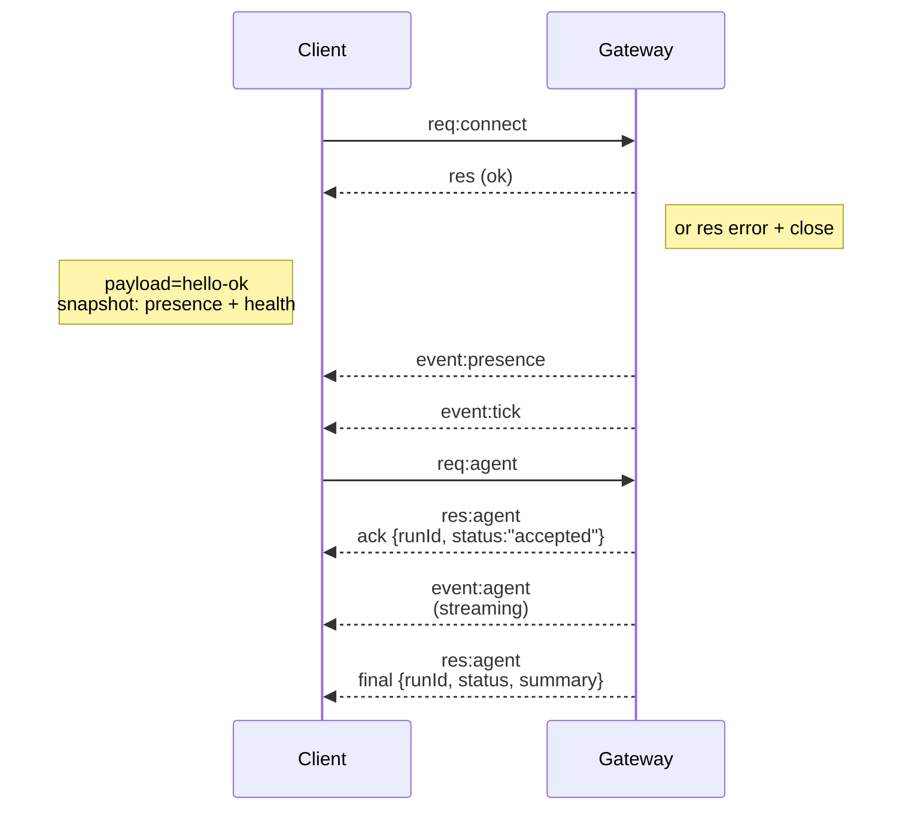

# OpenClaw 架构文档

## 概述

**OpenClaw** 是一个运行在用户自有设备上的个人AI助手。它能够在你已经使用的渠道（WhatsApp、Telegram、Slack、Discord、Google Chat、Signal、iMessage、IRC、Microsoft Teams、Matrix、飞书、LINE、Mattermost、Nextcloud Talk、Nostr、Synology Chat、Tlon、Twitch、Zalo、WebChat）上回答你的问题。它可以在 macOS/iOS/Android 上进行语音对话，并可以渲染一个由AI控制的实时Canvas画布。

## 核心设计理念

1. **本地优先（Local-first）**: 单个Gateway作为所有会话、渠道、工具和事件的控制平面
2. **多渠道集成**: 支持20+个主流 messaging 平台
3. **插件化架构**: 核心保持精简，可选功能通过插件提供
4. **安全优先**: 强大的默认安全设置，同时为高权限工作流提供明确的控制选项

---

## 系统架构总览

```
WhatsApp / Telegram / Slack / Discord / Google Chat / Signal / iMessage / IRC / 
Microsoft Teams / Matrix / 飞书 / LINE / Mattermost / Nextcloud Talk / Nostr / 
Synology Chat / Tlon / Twitch / Zalo / WebChat
                │
                ▼
┌───────────────────────────────┐
│            Gateway            │
│       (控制平面)               │
│     ws://127.0.0.1:18789      │
└──────────────┬────────────────┘
               │
               ├─ Pi agent (RPC)
               ├─ CLI (openclaw …)
               ├─ WebChat UI
               ├─ macOS app
               └─ iOS / Android nodes
```

---

## 核心组件

### 1. Gateway（网关）

Gateway是OpenClaw的核心守护进程，负责：

- **维护所有消息渠道的连接**（WhatsApp通过Baileys，Telegram通过grammY，Slack/Discord等）
- **暴露类型化的WebSocket API**（请求、响应、服务端推送事件）
- **验证入站帧**是否符合JSON Schema
- **发送事件**：如 `agent`、`chat`、`presence`、`health`、`heartbeat`、`cron`

#### 技术规格

- **默认端口**: `18789`
- **绑定地址**: `127.0.0.1`（可通过Tailscale Serve/Funnel暴露）
- **传输协议**: WebSocket，JSON文本帧

#### 启动方式

```bash
openclaw gateway --port 18789 --verbose
```

### 2. 客户端（Clients）

客户端通过WebSocket连接到Gateway，包括：

- **macOS应用**: 菜单栏控制平面、Voice Wake、Talk Mode、WebChat、调试工具
- **CLI**: `openclaw agent`、`openclaw message send` 等命令
- **Web管理界面**: Control UI 和 WebChat
- **自动化脚本**: 通过WS API进行集成

### 3. 节点（Nodes）

设备节点通过WebSocket连接到Gateway，声明 `role: node` 并提供设备能力：

- **macOS节点**: `system.run`、`system.notify`、Canvas、摄像头、屏幕录制、定位
- **iOS节点**: Canvas、Voice Wake、Talk Mode、摄像头、屏幕录制、Bonjour配对
- **Android节点**: 连接标签页、聊天会话、语音标签、Canvas、摄像头/屏幕录制、Android设备命令

### 4. Agent运行时

OpenClaw使用 **Pi agent** 运行时（在RPC模式下运行），支持：

- 工具流式输出（tool streaming）
- 块流式输出（block streaming）
- 会话管理（main会话、群组隔离、激活模式、队列模式、回复策略）

---

## 项目结构

```
openclaw-main/
├── apps/                    # 客户端应用
│   ├── android/            # Android应用
│   ├── ios/                # iOS应用
│   ├── macos/              # macOS应用
│   └── shared/             # 共享代码库
├── packages/               # npm包
│   ├── clawdbot/
│   └── moltbot/
├── extensions/             # 插件扩展
│   ├── acpx/
│   ├── discord/
│   ├── telegram/
│   ├── slack/
│   ├── whatsapp/
│   ├── memory-core/
│   ├── memory-lancedb/
│   └── ... (40+个扩展)
├── src/                    # 核心源代码
│   ├── gateway/            # Gateway实现
│   ├── agents/             # Agent相关
│   ├── channels/           # 渠道实现
│   ├── cli/                # CLI工具
│   ├── sessions/           # 会话管理
│   ├── browser/            # 浏览器控制
│   ├── canvas-host/        # Canvas主机
│   └── ... (60+个模块)
├── docs/                   # 文档
├── skills/                 # 内置技能
└── package.json            # 项目配置
```

---

## 协议与通信

### WebSocket协议

#### 握手流程



#### 帧格式

- **请求**: `{type:"req", id, method, params}` → `{type:"res", id, ok, payload|error}`
- **事件**: `{type:"event", event, payload, seq?, stateVersion?}`

#### 认证

- 如果设置了 `OPENCLAW_GATEWAY_TOKEN`（或 `--token`），`connect.params.auth.token` 必须匹配
- 幂等性键（Idempotency keys）对有副作用的方法（`send`、`agent`）是必需的

### 设备配对与本地信任

- 所有WS客户端（操作员+节点）在 `connect` 时包含 **设备身份**
- 新设备ID需要配对批准；Gateway为后续连接颁发 **设备令牌**
- **本地**连接（loopback或gateway主机的tailnet地址）可以自动批准
- 所有连接必须对 `connect.challenge` nonce进行签名

---

## 渠道支持

OpenClaw支持20+个消息渠道：

| 渠道 | 库/框架 | 说明 |
|------|---------|------|
| WhatsApp | Baileys | 推荐 |
| Telegram | grammY | Bot模式 |
| Discord | discord.js | |
| Slack | @slack/bolt | |
| Google Chat | Chat API | |
| Signal | signal-cli | |
| iMessage | BlueBubbles (推荐) / imsg (传统) | |
| IRC | 原生实现 | |
| Microsoft Teams | Bot Framework | |
| Matrix | matrix-sdk | |
| 飞书 | @larksuiteoapi/node-sdk | |
| LINE | @line/bot-sdk | |
| Mattermost | 原生实现 | |
| Nextcloud Talk | 原生实现 | |
| Nostr | nostr-hooks | |
| Synology Chat | 原生实现 | |
| Tlon | @tloncorp/api | |
| Twitch | irc-upd | |
| Zalo | 官方API | |
| WebChat | Gateway内置 | |

---

## 插件系统

### 核心原则

- 核心保持精简；可选功能通常作为插件发布
- 首选npm包分发 + 本地扩展加载（开发时）
- 插件文档：[Plugin SDK](https://docs.openclaw.ai/tools/plugin)

### 官方扩展

- **memory-core / memory-lancedb**: 记忆存储
- **discord / slack / telegram / whatsapp**: 渠道扩展
- **phone-control**: Android设备控制
- **voice-call**: 语音通话
- **llm-task**: LLM任务管理

### MCP支持

通过 **mcporter**（https://github.com/steipete/mcporter）支持MCP：

- 添加或更改MCP服务器无需重启gateway
- 保持核心工具/上下文表面精简
- 减少MCP对核心稳定性和安全性的影响

---

## 安全模型

### 默认行为

- **DM配对**（`dmPolicy="pairing"`）: 未知发送者收到配对码，bot不处理其消息
- 使用 `openclaw pairing approve <channel> <code>` 批准
- 公共入站DM需要明确选择加入：`dmPolicy="open"` + `allowFrom: ["*"]`

### 沙箱模式

- **默认**: 工具在 **main** 会话的主机上运行，agent具有完整访问权限
- **群组/渠道安全**: 设置 `agents.defaults.sandbox.mode: "non-main"` 在per-session Docker沙箱中运行非main会话

### 安全默认值

- 允许列表: `bash`, `process`, `read`, `write`, `edit`, `sessions_list`, `sessions_history`, `sessions_send`, `sessions_spawn`
- 拒绝列表: `browser`, `canvas`, `nodes`, `cron`, `discord`, `gateway`

---

## 配置

### 最小配置

```json5
{
  agent: {
    model: "anthropic/claude-opus-4-6",
  },
}
```

### 完整配置

参考: [Configuration Reference](https://docs.openclaw.ai/gateway/configuration)

---

## 部署选项

### 本地运行（推荐）

```bash
npm install -g openclaw@latest
openclaw onboard --install-daemon
openclaw gateway --port 18789 --verbose
```

### Docker

```bash
docker-compose up -d
```

### 从源码构建

```bash
git clone https://github.com/openclaw/openclaw.git
cd openclaw
pnpm install
pnpm ui:build
pnpm build
pnpm gateway:watch
```

---

## 远程访问

### Tailscale（推荐）

```json5
{
  gateway: {
    tailscale: {
      mode: "serve",  // 或 "funnel"
    },
  },
}
```

- `serve`: 仅tailnet（通过Tailscale身份头）
- `funnel`: 公共HTTPS（需要共享密码认证）

### SSH隧道

```bash
ssh -N -L 18789:127.0.0.1:18789 user@host
```

---

## 关键技术栈

### 主要依赖

- **运行时**: Node.js ≥22.12.0
- **Agent框架**: @mariozechner/pi-agent-core
- **AI模型**: @mariozechner/pi-ai
- **WebSocket**: ws
- **HTTP服务器**: express
- **类型定义**: @sinclair/typebox → JSON Schema → Swift模型

### 构建工具

- **包管理**: pnpm
- **构建**: tsdown
- **测试**: vitest
- **代码检查**: oxlint
- **格式化**: oxfmt

---

## 运营与维护

### 健康检查

```bash
openclaw doctor
```

### 日志

- 日志输出到stdout
- 支持结构化日志格式

### 自动重启

- 使用 launchd（macOS）或 systemd（Linux）作为用户服务

---

## 参考资料

- [官方网站](https://openclaw.ai)
- [官方文档](https://docs.openclaw.ai)
- [Gateway架构](https://docs.openclaw.ai/concepts/architecture)
- [安全指南](https://docs.openclaw.ai/gateway/security)
- [配置参考](https://docs.openclaw.ai/gateway/configuration)

---

*最后更新: 2026-04-02*