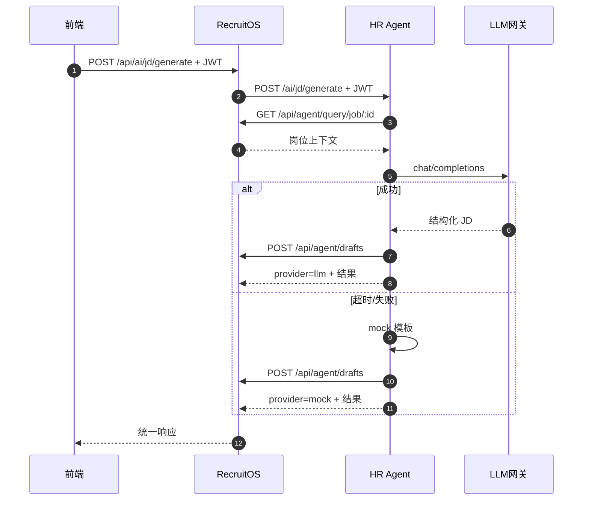

# HR Agent 说明文档

| 项目 | 内容 |
|------|------|
| 文档版本 | V1.0 |
| 编制日期 | 2026-08-06 |
| 服务版本 | hr-agent 1.0.0 |
| 默认端口 | `3002` |
| 代码目录 | `hr-agent/` |
| 适用范围 | 能力说明、接口约定、联调与运维、与 RecruitOS 边界 |

---

## 1. 文档说明

### 1.1 编写目的

本文档基于当前仓库 `hr-agent/` 实现，说明 HR Agent 的定位、架构、技能清单、接口、鉴权、LLM 降级策略以及与 RecruitOS 的协作方式，供研发、测试与评审使用。

### 1.2 系统定位

HR Agent 是 RecruitOS 的 **AI 能力侧车服务**：

| 组件 | 负责 | 不负责 |
|------|------|--------|
| HR Agent | 理解、生成、推荐、话术与分析草稿；必要时回调 RecruitOS 读数/落草稿 | 最终业务写库、审批、高风险动作的无确认执行 |
| RecruitOS | 数据、规则、权限、执行、审计、人工确认闸门 | 模型选型与提示词工程 |

调用关系：

```
前端 / 业务 API
    │  JWT
    ▼
RecruitOS :3001  ──代理──►  HR Agent :3002
    ▲                         │
    └──── 工具回调（同一 JWT）──┘
              │
              ▼
         LLM 网关（可选）/ Mock 降级
```

### 1.3 设计原则

| 原则 | 说明 |
|------|------|
| AI 与执行解耦 | Agent 产出草稿与建议；RecruitOS 负责落正式数据与执行 |
| 用户身份透传 | 全程使用业务用户 JWT，权限与审计归属真实操作人 |
| 可离线演示 | 无 API Key 时走规则/模板 mock，业务不断流 |
| 高风险不下放 | 淘汰、发 Offer、外部渠道触达等只提交建议或进闸门，不由 Agent 直接终态执行 |
| 外部渠道合规 | 寻聘外部打招呼仅可提交 `EXTERNAL_OUTREACH` 待确认，不直连第三方爬虫 |

---

## 2. 总体架构

### 2.1 逻辑架构

```
┌─────────────────────────────────────────────────────────┐
│ 接入：RecruitOS /api/ai/* 代理 或 直连 HR Agent /ai/*     │
└────────────────────────────┬────────────────────────────┘
                             │ Bearer JWT
┌────────────────────────────▼────────────────────────────┐
│ hr-agent Express（src/index.ts）                         │
│  /health  /ai/capabilities  /ai/<skill>                  │
└────────────────────────────┬────────────────────────────┘
                             │
        ┌────────────────────┼────────────────────┐
        ▼                    ▼                    ▼
  skills.ts            llm.ts               recruitos.ts
  业务技能编排          OpenAI 兼容调用         回调 RecruitOS
  + mock 模板          超时/重试/降级           drafts/actions/报表
```

### 2.2 代码结构

```
hr-agent/
├── package.json
├── .env                 # 端口、RecruitOS 地址、LLM 配置
├── src/
│   ├── index.ts         # Express 入口与路由
│   ├── config.ts        # 环境配置
│   ├── loadEnv.ts       # 加载 .env
│   ├── llm.ts           # chatCompletion / chatOrMock / JSON 解析
│   ├── recruitos.ts     # RecruitOsClient（JWT 回调）
│   └── skills.ts        # 全部 AI 技能实现
├── scripts/             # 联调探针（probe-*.js）
└── dist/                # tsc 产物
```

### 2.3 技术选型

| 项 | 选型 |
|----|------|
| 运行时 | Node.js + TypeScript（`tsx` 开发 / `tsc` 构建） |
| HTTP | Express 5 + CORS |
| LLM | OpenAI 兼容 `POST /chat/completions` |
| 依赖 | 轻量（express、cors、zod）；业务逻辑主要在 `skills.ts` |

---

## 3. 与 RecruitOS 集成

### 3.1 双向调用

| 方向 | 路径 | 说明 |
|------|------|------|
| RecruitOS → HR Agent | `HR_AGENT_URL`（默认 `http://127.0.0.1:3002`） | `backend/src/services/hrAgentClient.ts` 代理 `/api/ai/*`，默认超时 120s |
| HR Agent → RecruitOS | `RECRUITOS_BASE_URL`（默认 `http://127.0.0.1:3001`） | `RecruitOsClient` 透传用户 JWT |

### 3.2 鉴权

1. 前端登录 RecruitOS，携带 JWT 调用 `/api/ai/...`。
2. RecruitOS 将同一 `Authorization: Bearer <token>` 转发给 HR Agent。
3. HR Agent 所有 `/ai/*`（除健康/能力清单外业务接口）要求 Bearer；缺失则 `401`。
4. 回调 RecruitOS 时继续使用该 token，保证 **数据权限与审计归属业务用户**。

### 3.3 常用回调能力（RecruitOsClient）

| 方法 | RecruitOS 接口 | 用途 |
|------|----------------|------|
| `query(type, id)` | `GET /api/agent/query/:type/:id` | 读岗位/候选人/应聘等上下文 |
| `search` | `GET /api/agent/search` | 语义/关键字检索（预留） |
| `saveDraft` | `POST /api/agent/drafts` | 保存 AI 草稿（`agentId=hr-agent`） |
| `proposeAction` | `POST /api/agent/actions` | 提议动作（如加标签） |
| `overview` / `funnel` / `channelRoi` | `/api/reports/*` | 分析技能取数 |
| 直接 `get`/`post` | 如人才库、日历忙闲、渠道 outreach | 技能按需扩展 |

### 3.4 代理路径对照

RecruitOS 对外暴露的路径与 HR Agent 一一对应（前缀 `/api/ai` ↔ `/ai`）：

| RecruitOS | HR Agent |
|-----------|----------|
| `GET /api/ai/health` | `GET /health`（经客户端探测） |
| `GET /api/ai/capabilities` | `GET /ai/capabilities` |
| `POST /api/ai/jd/generate` | `POST /ai/jd/generate` |
| `POST /api/ai/jd/publish-pack` | `POST /ai/jd/publish-pack` |
| `POST /api/ai/sourcing/run` | `POST /ai/sourcing/run` |
| `POST /api/ai/resume/parse` | `POST /ai/resume/parse` |
| `POST /api/ai/resume/screen` | `POST /ai/resume/screen` |
| `POST /api/ai/talent/recommend` | `POST /ai/talent/recommend` |
| `POST /api/ai/interview/schedule-assist` | `POST /ai/interview/schedule-assist` |
| `POST /api/ai/interview/summary` | `POST /ai/interview/summary` |
| `POST /api/ai/interview/multimodal-assess` | `POST /ai/interview/multimodal-assess` |
| `POST /api/ai/nurture/reply` | `POST /ai/nurture/reply` |
| `POST /api/ai/offer/draft` | `POST /ai/offer/draft` |
| `POST /api/ai/analytics/ask` | `POST /ai/analytics/ask` |
| `POST /api/ai/chat` | `POST /ai/chat` |

---

## 4. LLM 层

### 4.1 启用条件

- 配置了非空 `OPENAI_API_KEY` → `llmEnabled() === true`，走真实网关。
- 未配置 → 全部技能走内置 mock 模板（`provider: "mock"`）。

### 4.2 调用行为（`llm.ts`）

| 行为 | 说明 |
|------|------|
| 协议 | `POST {OPENAI_BASE_URL}/chat/completions` |
| 超时 | `LLM_TIMEOUT_MS`（默认 90000；演示环境常设 ~55000 以匹配网关） |
| 重试 | 默认最多 2 次；对 429/502/504、超时、`ECONNRESET` 退避重试 |
| JSON | 可选 `LLM_FORCE_JSON=1` 时附加 `response_format=json_object`（部分网关不支持，默认不强制） |
| 降级 | `chatOrMock`：LLM 失败则调用技能内 mock，并标记 `provider: "mock"` |
| 解析 | `safeJsonParse` 剥离 markdown 代码块后解析；失败用 fallback |

### 4.3 响应约定

多数技能返回体包含：

- `provider`: `"llm"` | `"mock"`
- 业务字段（JD、评分、话术等）
- 可选 `draft`：RecruitOS `AgentDraft` 记录

---

## 5. 技能能力清单

### 5.1 总览

| key | 名称 | 接口 | 是否可启动 |
|-----|------|------|------------|
| jd | 职位需求诊断与 JD 生成 | `POST /ai/jd/generate` | 是 |
| publish | JD 多渠道发布文案 | `POST /ai/jd/publish-pack` | 是 |
| sourcing | AI 寻聘助手（站内） | `POST /ai/sourcing/run` | 是 |
| resume | 简历解析与初筛 | `POST /ai/resume/parse`、`/screen` | 是 |
| talent | 人才库推荐与激活 | `POST /ai/talent/recommend` | 是 |
| schedule | 面试日程协调 | `POST /ai/interview/schedule-assist` | 是 |
| ai_interview | AI 面试多模态测评（文本增强） | `POST /ai/interview/multimodal-assess` | 是 |
| eval | 面试评价汇总 | `POST /ai/interview/summary` | 是 |
| nurture | 候选人沟通体验 | `POST /ai/nurture/reply` | 是 |
| offer | Offer 与入职衔接草稿 | `POST /ai/offer/draft` | 是 |
| analytics | 招聘数据智能分析 | `POST /ai/analytics/ask` | 是 |
| chat | 通用对话（含意图路由） | `POST /ai/chat` | 是 |

能力清单也可通过 `GET /ai/capabilities` 获取。

### 5.2 各技能说明

#### 5.2.1 JD 生成 `generateJd`

| 项 | 内容 |
|----|------|
| 入参 | `jobId?`、`requestId?`、`brief?`、`dialogue?`、`saveDraft?`（默认保存） |
| 行为 | 拉取岗位/需求上下文 → LLM/Mock 输出结构化 JSON → 格式化为市场风格纯文本 `externalJd` + 内部版 `internalJd` |
| 落库 | `AgentDraft type=JD` |
| 出参要点 | `title/location/salary/...`、`responsibilities`、`requirements`、`persona`、`optimizationTips`、`followUpQuestions`、`provider`、`draft` |

#### 5.2.2 多渠道文案包 `publishPack`

| 项 | 内容 |
|----|------|
| 入参 | `jobId`（必填）、`channels?`（默认 BOSS/LIEPIN/INTERNAL/REFERRAL） |
| 行为 | 按渠道生成差异化标题与正文 |
| 落库 | `AgentDraft type=NOTICE` |
| 出参 | `{ packs:[{channel,title,body,tips}], provider, draft }` |

#### 5.2.3 寻聘助手 `sourcingAssistant`

| 项 | 内容 |
|----|------|
| 入参 | `jobId`（必填）、`count?`、`strategy?`、`autoTag?`、`submitOutreach?`、`channelCode?` |
| 行为 | 从人才库/候选人池挑名单 + 首轮话术；可选 `ADD_TAG`；可选提交渠道外部打招呼 |
| 合规 | `submitOutreach=true` 时 `POST /api/channels/outreach/submit` → `EXTERNAL_OUTREACH` 待人工确认；**不直接外呼** |
| 出参 | `targets`、`marketHints`、`complianceNote`、`outreachSubmit`、`draft` |

#### 5.2.4 简历解析 `parseResume`

| 项 | 内容 |
|----|------|
| 入参 | `candidateId`（必填）、`resumeText?` |
| 行为 | 结构化教育/经历/技能/项目/异常点；尝试 `POST /api/p2/candidates/:id/apply-parse` 回写 |
| 落库 | `AgentDraft type=SCREEN` |
| 出参 | `parsed`、`confidence`、`provider` |

#### 5.2.5 简历初筛 `screenResume`

| 项 | 内容 |
|----|------|
| 入参 | `candidateId`、`jobId`（均必填） |
| 行为 | JD 语义匹配评分；结合重复投递探测 |
| 出参 | `score0to100`、`level`、`reasons`、`risks`、`recommendedAction`、`duplicateSuspected` |

#### 5.2.6 人才库推荐 `recommendTalent`

| 项 | 内容 |
|----|------|
| 入参 | `jobId`（必填）、`limit?` |
| 行为 | 从 `/api/talent-pool` 挑选并生成激活话术 |
| 出参 | `recommendations[{candidateId,name,score,reason,activateMessage}]` |

#### 5.2.7 面试排期辅助 `scheduleAssist`

| 项 | 内容 |
|----|------|
| 入参 | `applicationId?`、`interviewId?`、`preferredDays?` |
| 行为 | 生成工作日候选时段 + 候选人/面试官沟通文案；参考日历忙闲 |
| 出参 | `suggestions`、`messageToCandidate`、`messageToInterviewers`、`notes` |

#### 5.2.8 评价汇总 `interviewSummary`

| 项 | 内容 |
|----|------|
| 入参 | `applicationId`（必填） |
| 行为 | 汇总多轮评价，仅建议决策，不执行录用/淘汰 |
| 落库 | `AgentDraft type=EVAL_SUMMARY` |
| 出参 | `summary`、`strengths`、`risks`、`suggestedDecision` |

#### 5.2.9 多模态测评（文本增强）`multimodalInterviewAssess`

| 项 | 内容 |
|----|------|
| 入参 | `applicationId`（必填）、`transcript?`、`audioSignals?`、`videoSignals?` |
| 行为 | 基于文本（及可选音视频线索占位）输出多维评分；强调人工终裁 |
| 现状 | `mode: text-enhanced-multimodal`；真实 A/V 特征待后续接入 |
| 出参 | `dimensions`、`summary`、`riskFlags`、`followUpQuestions`、`decisionBoundary` |

#### 5.2.10 候选人沟通 `nurtureReply`

| 项 | 内容 |
|----|------|
| 入参 | `question`（必填）、`jobId?`、`applicationId?`、`intent?` |
| 行为 | 有温度、不编造的 FAQ 式回复；内置福利/进度等知识片段 |
| 出参 | `reply`、`tone`、`suggestedStatusUpdate` |

#### 5.2.11 Offer 草稿 `offerDraft`

| 项 | 内容 |
|----|------|
| 入参 | `applicationId`（必填）、`packageHint?` |
| 行为 | 生成录用通知草稿与入职清单；薪资可占位 |
| 风险 | 返回 `riskNote`：正式发送须 RecruitOS 人工确认 |
| 落库 | `AgentDraft type=OFFER` |

#### 5.2.12 数据分析 `analyticsAsk`

| 项 | 内容 |
|----|------|
| 入参 | `question`（必填） |
| 行为 | 拉取 overview/funnel/渠道质量后生成洞察与行动建议 |
| 出参 | `answer`、`insights`、`actions`、`dataHighlights` |

#### 5.2.13 通用对话 `chat`

| 项 | 内容 |
|----|------|
| 入参 | `message`（必填）、`history?`、`context?`（如 `jobId`/`candidateId`/`intent`） |
| 行为 | 轻量正则/意图路由到具体技能；否则自由对话 |
| 可路由意图 | JD、初筛、分析、排期、寻访、多模态测评 |

---

## 6. HTTP 接口细则

### 6.1 公共约定

- Base：`http://127.0.0.1:3002`
- Content-Type：`application/json`
- 鉴权：业务接口需 `Authorization: Bearer <RecruitOS JWT>`
- 成功：直接返回业务 JSON
- 失败：`{ message }`，HTTP 401/400/500

### 6.2 运维接口

#### `GET /health`

```json
{
  "ok": true,
  "name": "hr-agent",
  "version": "1.0.0",
  "llm": "openai-compatible",
  "recruitos": "http://127.0.0.1:3001"
}
```

`llm` 为 `openai-compatible` 或 `mock`。

#### `GET /ai/capabilities`

返回 §5.1 能力数组（无需业务鉴权，当前实现未强制 JWT）。

### 6.3 业务接口校验摘要

| 接口 | 必填字段 |
|------|----------|
| `/ai/jd/publish-pack` | `jobId` |
| `/ai/resume/parse` | `candidateId` |
| `/ai/resume/screen` | `candidateId`、`jobId` |
| `/ai/talent/recommend` | `jobId` |
| `/ai/sourcing/run` | `jobId` |
| `/ai/interview/summary` | `applicationId` |
| `/ai/interview/multimodal-assess` | `applicationId` |
| `/ai/nurture/reply` | `question` |
| `/ai/offer/draft` | `applicationId` |
| `/ai/analytics/ask` | `question` |
| `/ai/chat` | `message` |

---

## 7. 配置与启动

### 7.1 环境变量（`hr-agent/.env`）

| 变量 | 默认 | 说明 |
|------|------|------|
| `PORT` | `3002` | 监听端口（绑定 `127.0.0.1`） |
| `RECRUITOS_BASE_URL` | `http://127.0.0.1:3001` | 回调地址 |
| `OPENAI_API_KEY` | 空 | 有值则启用 LLM |
| `OPENAI_BASE_URL` | `https://api.openai.com/v1` | 兼容网关根路径（含 `/v1`） |
| `OPENAI_MODEL` | `gpt-4o-mini` | 模型名 |
| `LLM_TIMEOUT_MS` | `90000` | 单次补全超时 |
| `LLM_FORCE_JSON` | 未设 | 设为 `1` 时强制 json_object |

RecruitOS 侧：`HR_AGENT_URL` 指向本服务。

> 请勿将真实 API Key 写入文档或提交到公开仓库；本地 `.env` 应纳入忽略规则。

### 7.2 启动命令

```bash
# 仓库根目录
npm run dev:hr-agent   # 或进入 hr-agent 后 npm run dev

# 生产构建
cd hr-agent && npm run build && npm start
```

建议同时启动：

```bash
npm run dev:backend    # :3001
npm run dev:hr-agent   # :3002
npm run dev:frontend   # :5173
```

### 7.3 联调检查

1. `GET http://127.0.0.1:3002/health` → `ok: true`
2. 登录 RecruitOS 取 JWT
3. `POST /api/ai/jd/generate`（经 RecruitOS）或直连 `/ai/jd/generate` 带 Bearer
4. 查看返回 `provider` 与 RecruitOS 草稿列表

仓库内另有 `hr-agent/scripts/probe-*.js` 可用于探测 LLM 网关连通性。

---

## 8. 安全、合规与边界

| 主题 | 现状 |
|------|------|
| 身份 | 必须用户 JWT；无服务账号绕过 |
| 高风险 | Offer/淘汰等仅草稿或建议；渠道外部触达进人工闸门 |
| 敏感信息 | Offer 草稿可对薪资占位；脱敏依赖 RecruitOS query 层 |
| 外部平台 | 不实现托管登录爬取；寻聘外呼走 RecruitOS 渠道适配层 |
| 多模态 | 当前文本增强；非全量实时音视频评分 |
| 监听地址 | 默认仅 `127.0.0.1`，生产需网关/防火墙策略 |

---

## 9. 典型时序（JD 生成）



---

## 10. 已知限制与演进建议

| 优先级 | 建议 |
|--------|------|
| P0 | 按真实渠道中台字段对齐寻聘/发布联调；生产密钥与密钥轮换 |
| P1 | 技能拆分模块文件、补充契约测试与 Zod 入参校验落地 |
| P1 | 简历文件 OCR/解析流水线（当前偏文本与已有字段） |
| P2 | 全量多模态音视频特征接入 |
| P2 | 独立限流、可观测性（traceId、技能耗时指标） |

---

## 11. 附录

### 11.1 相关文档

- 《RecruitOS 系统架构文档》`docs/系统架构文档.md`（§6.3 双向调用、§6.4 渠道合规）
- 《数据库与数据模型分析》`docs/数据库与数据模型分析.md`（`AgentDraft` / `AgentAction`）
- 需求来源：`docs/HR Agent共性需求汇总（招聘） 0729.xlsx`

### 11.2 草稿类型对照（AgentDraft.type）

| type | 典型技能 |
|------|----------|
| `JD` | JD 生成 |
| `NOTICE` | 发布文案、寻聘、排期、候选人沟通 |
| `SCREEN` | 解析、初筛 |
| `EVAL_SUMMARY` | 评价汇总、多模态测评 |
| `OFFER` | Offer 草稿 |

### 11.3 版本记录

| 版本 | 日期 | 说明 |
|------|------|------|
| V1.0 | 2026-08-06 | 基于当前 `hr-agent` 实现首次成文 |

---

*— 文档结束 —*
