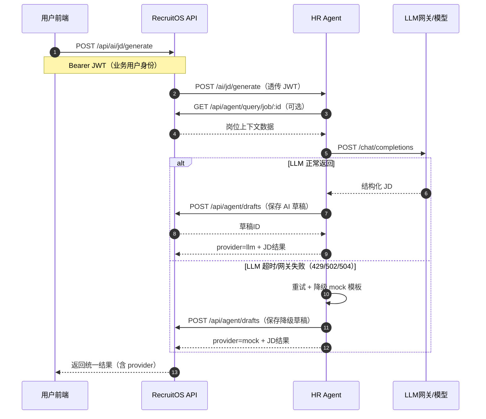
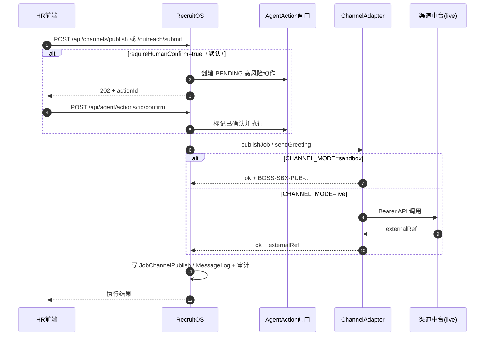

# RecruitOS 招聘管理系统 — 系统架构文档

| 项目 | 内容 |
|------|------|
| 文档版本 | V2.2 |
| 编制日期 | 2026-08-05 |
| 系统版本 | 2.2.0（一期 + 二期 + HR Agent + 渠道适配/合规闸门） |
| 适用范围 | 架构设计、开发交接、评审与运维参考 |

---

## 1. 文档说明

### 1.1 编写目的

本文档描述 RecruitOS（recruit-agent）招聘管理系统的总体架构、分层设计、核心数据模型、模块划分、接口边界、安全权限与部署结构，作为研发、测试与后续 HR Agent 集成的共同依据。

### 1.2 系统定位

建设一套 **RecruitOS（业务系统）+ HR Agent（AI 能力）** 协同架构：

- **第一阶段**：跑通招聘全流程闭环（需求→入职），数据留痕、责任清楚。
- **第二阶段**：标准化、可配置、可集成；开放受控接口供 HR Agent 读写。
- **HR Agent**：承接共性需求中的理解/生成/推荐；**RecruitOS 依赖 HR Agent 提供 AI**，自身不内置大模型调用。

职责边界：

| 组件 | 负责 | 不负责 |
|------|------|--------|
| HR Agent | 模型、提示词、语义理解、草稿生成、推荐与分析话术 | 最终业务写库与高风险执行 |
| RecruitOS | 数据、规则、权限、执行、审计、人工确认 | 模型选型与提示词工程 |

### 1.3 设计原则

| 原则 | 说明 |
|------|------|
| 流程先完整 | 优先保证需求到入职可闭环 |
| 对象要分清 | 候选人主档与应聘记录分离 |
| 结果有留痕 | 推进、淘汰、审批、状态变更均记录操作人/时间/原因 |
| AI 与系统解耦 | 基础系统执行；Agent 理解、生成、推荐 |
| 高风险人工确认 | 淘汰、发/撤 Offer、渠道发布、外部打招呼等不得由 Agent 无确认直接执行 |

---

## 2. 总体架构

### 2.1 逻辑架构

```
┌─────────────────────────────────────────────────────────────────┐
│                        接入层 Access                              │
│  PC 管理后台 (React)  │  候选人外链门户 (/portal/:token)          │
└───────────────────────────────┬─────────────────────────────────┘
                                │ HTTPS / JSON
┌───────────────┬───────────────▼────────────────┬────────────────┐
│               │      RecruitOS API (:3001)      │                │
│  /api/ai/* ───┼──► 代理转发用户 JWT ────────────┼──► HR Agent    │
│               │      业务 /agent /jobs …        │    (:3002)     │
│               │◄──── 工具回调（查询/草稿/动作）───┼── LLM/Mock     │
└───────────────┴────────────────────────────────┴────────────────┘
```

RecruitOS 通过 `HR_AGENT_URL`（默认 `http://localhost:3002`）调用 AI；HR Agent 通过 `RECRUITOS_BASE_URL` 回调业务 API。

### 2.1 逻辑架构（RecruitOS 内部）

```
┌─────────────────────────────────────────────────────────────────┐
│                        接入层 Access                              │
│  PC 管理后台 (React)  │  候选人外链门户 (/portal/:token)          │
│  HR Agent 调用方      │  渠道中台/开放平台（Boss/猎聘 live）       │
└───────────────────────────────┬─────────────────────────────────┘
                                │ HTTPS / JSON
┌───────────────────────────────▼─────────────────────────────────┐
│                     API 网关层（Express）                          │
│  JWT 鉴权 │ RBAC │ CORS │ 静态附件 │ 统一错误处理                   │
└───────────────────────────────┬─────────────────────────────────┘
                                │
┌───────────────────────────────▼─────────────────────────────────┐
│                        业务服务层                                  │
│  ┌──────────┐ ┌──────────┐ ┌──────────┐ ┌──────────┐            │
│  │招聘主流程 │ │协同与面试 │ │Offer入职 │ │人才与报表 │            │
│  └──────────┘ └──────────┘ └──────────┘ └──────────┘            │
│  ┌──────────┐ ┌──────────┐ ┌──────────┐ ┌──────────┐            │
│  │岗位标准  │ │流程SLA   │ │渠道适配  │ │Agent基础 │            │
│  └──────────┘ └──────────┘ │合规+闸门 │ └──────────┘            │
│                            └──────────┘                          │
└───────────────────────────────┬─────────────────────────────────┘
                                │
┌───────────────────────────────▼─────────────────────────────────┐
│              领域支撑：待办 / 审计 / 活动流 / 业务事件 / 幂等        │
└───────────────────────────────┬─────────────────────────────────┘
                                │ Prisma ORM
┌───────────────────────────────▼─────────────────────────────────┐
│                     数据层 Data                                    │
│              SQLite（开发默认） / 可切换 PostgreSQL 等               │
│              附件目录 uploads/                                     │
└─────────────────────────────────────────────────────────────────┘
```

### 2.2 API 网关层实现说明

文档中的「API 网关层」**不是**独立的 Kong / Nginx Gateway 等产品，而是 **Express 应用入口 + 中间件** 在模块化单体内承担的统一接入职责，与业务路由运行在同一后端进程（`backend/src/index.ts` + `middleware/auth.ts`）。

#### 实现落点

| 能力 | 实现方式 |
|------|----------|
| 统一入口 | 所有业务 API 挂在 `/api/*`，附件在 `/uploads` |
| 跨域 | `app.use(cors())` |
| 请求体解析 | `express.json({ limit: '10mb' })` |
| 路由分发 | `app.use('/api/xxx', xxxRoutes)` 按业务域转发 |
| JWT 鉴权 | 路由上的 `authRequired`：校验 `Authorization: Bearer ...`，查库确认账号未停用，写入 `req.user` |
| RBAC | `requireRoles('HR', ...)`；`ADMIN` 默认放行 |
| 健康检查 | `GET /api/health` |
| 统一错误 | 末尾 error middleware 返回 `{ message }` |
| 静态附件 | `/uploads` 直接提供文件 |

候选人外链接口（`/api/links/portal/:token`）**不走登录 JWT**，靠限时 token 鉴权，仍由同一 Express 应用对外提供。

#### 与前端的关系

开发态由 Vite 代理扮演前置转发（见 `frontend/vite.config.ts`）：

- 浏览器访问 `:5173/api`、`/uploads` → 代理到后端 `:3001`
- 目的是前后端同域开发，**不是**独立网关服务

#### 小结与演进

当前为 **Express 中间件式网关**，而非独立网关集群。生产环境若需真正网关，可在前面增加 Nginx / Ingress 做 TLS、限流、负载均衡；现有 Express 继续负责业务鉴权与路由分发。

### 2.3 技术架构

| 层次 | 技术选型 | 说明 |
|------|----------|------|
| 前端 | React 18 + TypeScript + Vite + Ant Design 5 + Recharts | SPA 管理后台 + 候选人门户 |
| 后端 | Node.js + Express 5 + TypeScript (tsx) | REST API（含网关层职责） |
| ORM | Prisma 5 | 模型驱动、迁移与种子 |
| 数据库 | SQLite（默认 `file:./dev.db`） | 本地零配置；生产可换 PostgreSQL |
| 认证 | JWT（Bearer，默认 7 天） | 密码 bcrypt 哈希 |
| 图表 | Recharts | 漏斗与统计可视化 |
| 文档/构建 | npm workspaces 风格双包 | `backend/` + `frontend/` |

### 2.4 物理/部署视图（当前）

```
开发机
├── frontend :5173  ──proxy──►  backend :3001
│   Vite Dev Server              Express API（网关层 + 业务层同进程）
│                                ├── /api/*
│                                ├── /uploads/*
│                                └── channels/*（适配层；sandbox 或 live→渠道中台）
├── hr-agent :3002               AI 能力（可回调 /api/channels/outreach/submit）
└── prisma/dev.db + uploads/
```

生产建议（未强制实现）：反向代理（Nginx）终止 TLS，前端静态资源与 `/api` 同域转发；数据库独立实例；附件对象存储；渠道 live 仅指向自有合规中台，不直连第三方爬虫。

---

## 3. 分层与目录结构

### 3.1 仓库结构

```
recruit-agent/
├── backend/
│   ├── prisma/schema.prisma      # 数据模型
│   ├── .env                      # 含渠道合规开关（CHANNEL_*）
│   ├── src/
│   │   ├── index.ts              # 入口与路由挂载
│   │   ├── prisma.ts             # PrismaClient 单例
│   │   ├── loadEnv.ts            # 加载 .env
│   │   ├── config/compliance.ts  # 渠道合规开关与拦截
│   │   ├── channels/             # 渠道适配层
│   │   │   ├── types.ts          # ChannelAdapter 抽象
│   │   │   ├── adapters.ts       # Boss/猎聘/sandbox 实现
│   │   │   ├── registry.ts       # 适配器注册与健康检查
│   │   │   └── service.ts        # 发布/打招呼执行与落库
│   │   ├── middleware/auth.ts    # JWT + RBAC
│   │   ├── utils/helpers.ts      # 审计/待办/事件/脱敏
│   │   ├── routes/*.ts           # 业务路由（含 channels / agent / ai）
│   │   └── seed.ts               # 演示数据（含 BOSS / LIEPIN 渠道）
│   └── uploads/                  # 简历等附件
├── hr-agent/                     # AI 服务（寻聘可提交外部触达闸门）
├── frontend/
│   ├── src/
│   │   ├── App.tsx / layout/     # 路由与侧栏
│   │   ├── api.ts / auth.tsx     # HTTP 与登录态
│   │   ├── constants.ts          # 状态字典
│   │   └── pages/                # 业务页面（Channels / Agent 含闸门 UI）
│   └── vite.config.ts            # /api、/uploads 代理
├── docs/                         # 架构与说明文档
└── README.md
```

### 3.2 后端分层职责

| 层 | 职责 | 典型文件 |
|----|------|----------|
| 路由层 | HTTP 入参校验、编排闸门/适配、返回 JSON | `routes/*.ts` |
| 中间件 | 鉴权、角色校验 | `middleware/auth.ts` |
| 合规配置 | 渠道模式、开关、凭证校验 | `config/compliance.ts` |
| 渠道适配 | 统一抽象 + Boss/猎聘 sandbox/live | `channels/*` |
| 支撑工具 | 审计日志、待办、流程事件、业务事件、脱敏 | `utils/helpers.ts` |
| 数据访问 | Prisma Client | `prisma.ts` + schema |

当前为**模块化单体（Modular Monolith）**：单进程内按业务域拆分路由，便于二期拆分为独立服务。

---

## 4. 核心业务域与模块

### 4.1 招聘主流程（一期）

```
招聘需求 ─► 职位发布 ─► 简历/候选人 ─► 筛选 ─► 面试/评价
    ─► Offer ─► 待入职 ─► 入职归档（回写需求/职位人数）
未录用：淘汰 / 放弃 / 进入人才库（明确终态）
```

| 模块 | API 前缀 | 前端路由 |
|------|----------|----------|
| 工作台 | `/api/workbench` | `/` |
| 招聘需求 | `/api/requests` | `/requests` |
| 职位 | `/api/jobs` | `/jobs` |
| 候选人 | `/api/candidates` | `/candidates` |
| 应聘/筛选 | `/api/applications` | `/pipeline` |
| 面试评价 | `/api/interviews` | `/interviews` |
| Offer | `/api/offers` | `/offers` |
| 待入职 | `/api/onboarding` | `/onboarding` |
| 人才库 | `/api/talent-pool` | `/talent-pool` |
| 基础报表 | `/api/reports` | `/reports` |
| 配置权限 | `/api/config` | `/settings` |
| 认证 | `/api/auth` | `/login` |

### 4.2 进阶与 Agent 基础（二期）

| 模块 | API 前缀 | 前端路由 | 能力摘要 |
|------|----------|----------|----------|
| 岗位标准 | `/api/standards` | `/standards` | 模板版本、评价模型、校准 |
| 流程 SLA | `/api/flows` | `/flows` | 流程模板、SLA、预警 |
| 渠道 | `/api/channels` | `/channels` | 账号映射、适配器发布/触达、合规状态、人工闸门 |
| 消息 | `/api/messages` | `/messages` | 发送/重试；外部打招呼结果写入 MessageLog |
| 安全链接 | `/api/links` | `/portal/:token` | 面试/Offer 外链确认 |
| Agent | `/api/agent` | `/agent` | 查询/草稿/动作确认（含渠道高风险动作）/事件/语义 |
| 二期综合 | `/api/p2` | （嵌入各页） | 解析、合并、日历、保温、协同、电子签预留 |

### 4.3 候选人外链门户

- **无内部账号**，凭限时 `token` 访问。
- 类型：`INTERVIEW_CONFIRM` / `SLOT_PICK` / `OFFER_CONFIRM` / `SUPPLEMENT`。
- 过期或禁用返回 410/404；Offer 确认记录设备与 IP，接受后自动创建待入职与跨部门协同任务。

---

## 5. 数据架构

### 5.1 核心对象关系

```
Organization 1──* User
RecruitRequest 1──* Job 1──* Application *──1 Candidate
Application 1──* Interview 1──* InterviewEvaluation
Application 1──* Offer(版本) 0..1── Onboarding ──* OnboardCollabTask
Job *──* Channel (via JobChannelPublish)
FlowTemplate 1──* FlowNode
JobStandard / EvalModel ──应用到──► Job
SecureLink ──关联──► Candidate / Application / Interview / Offer
AgentDraft / AgentAction / BusinessEvent / SemanticDict
```

### 5.2 关键规则（与需求对齐）

| 规则 | 实现要点 |
|------|----------|
| BR-001 | 流程状态挂在 `Application`，不挂候选人主档 |
| 多岗位应聘 | 同一候选人多条 `Application`，状态互不覆盖 |
| Offer 版本 | 同一时间仅一份 `isActive`；关键字段变更升版重审 |
| 评价锁定 | 提交后默认不可由他人修改 |
| 入职回写 | 确认入职时更新 Job/Request 已入职人数 |
| Agent 高风险 | `AgentAction.riskLevel=HIGH` → `PENDING` → 人工确认后执行（含 `PUBLISH_CHANNEL` / `EXTERNAL_OUTREACH`） |
| 渠道发布留痕 | 确认执行后写 `JobChannelPublish`（含 `externalRef`） |
| 外部触达留痕 | 确认执行后写 `MessageLog`（`templateKey=EXTERNAL_OUTREACH`） |
| 幂等 | `AgentAction.idempotencyKey` 唯一，重复请求复用结果 |

### 5.3 一期核心实体（节选）

| 实体 | 说明 |
|------|------|
| User / Organization | 账号、角色、组织、数据范围 |
| RecruitRequest | 招聘需求与审批状态 |
| Job | 职位 JD、流程配置、发布状态 |
| Candidate | 候选人主档、人才库属性、解析结果 |
| Application | 应聘记录、筛选结果、SLA 字段 |
| ProcessEvent | 流程时间轴事件（统计口径不覆盖历史） |
| Interview / Evaluation | 面试场次与独立评价 |
| Offer / Onboarding | 录用与待入职 |
| Todo / AuditLog / Activity | 待办、审计、动态 |

### 5.4 二期扩展实体（节选）

| 实体 | 说明 |
|------|------|
| JobStandard / EvalModel | 岗位标准与评价模型（版本） |
| FlowTemplate / FlowNode / SlaRule | 可配置流程与时限 |
| Channel / JobChannelPublish | 渠道与发布记录 |
| SecureLink | 候选人安全链接 |
| MessageLog | 消息发送日志 |
| WarmTask / OnboardCollabTask | 保温与入职协同 |
| TalentActivation* | 人才激活任务 |
| AgentDraft / AgentAction | Agent 草稿与受控动作 |
| BusinessEvent / EventSubscription | 事件与订阅 |
| SemanticDict | 业务语义字典 |
| HireQualityRecord | 入职后质量回溯 |

---

## 6. 接口与集成架构

### 6.1 内部 API 风格

- 协议：HTTP JSON，`Authorization: Bearer <JWT>`（门户公开接口除外）。
- 成功：直接返回业务对象 / 列表。
- 失败：`{ message }`，HTTP 4xx/5xx；冲突类（查重、面试冲突）可带结构化 `data`。

### 6.2 Agent 接口分级

| 等级 | 示例 | 控制 |
|------|------|------|
| 读取 | `/api/agent/query/*`、`/search` | 继承发起人权限，敏感字段脱敏 |
| 生成草稿 | `/api/agent/drafts` | 标记 `AI_GENERATED`，不直接覆盖正式数据 |
| 低风险执行 | 加标签、建待办 | 可自动执行 |
| 高风险执行 | 淘汰、发/撤 Offer、渠道发布、外部打招呼 | 必须人工确认（`CHANNEL_REQUIRE_HUMAN_CONFIRM` 默认 true） |
| 禁止 | 绕过审批、改已提交评价、直写库、绕过合规开关直连外网 | 系统层不提供接口 |

### 6.3 RecruitOS 与 HR Agent 双向调用

#### 6.3.1 调用方向

| 方向 | 发起方 → 被调方 | 主要接口 | 目标 |
|------|------------------|----------|------|
| AI 编排调用 | RecruitOS → HR Agent | `/api/ai/*`（RecruitOS）→ `/ai/*`（HR Agent） | 让 RecruitOS 复用 HR Agent 的模型能力（JD、初筛、分析等） |
| 业务工具回调 | HR Agent → RecruitOS | `/api/agent/*`、`/api/jobs/*`、`/api/candidates/*`、`/api/reports/*`、`/api/p2/*` | 让 HR Agent 在权限内读写业务数据并落审计 |

#### 6.3.2 鉴权与身份传递

- 前端用户登录 RecruitOS 后，携带业务 JWT 访问 `/api/ai/*`。
- RecruitOS 代理层将同一 JWT 转发给 HR Agent（`Authorization: Bearer <token>`）。
- HR Agent 回调 RecruitOS 时继续使用该 JWT，确保 **数据权限与操作审计归属到真实业务用户**，而非匿名服务账号。
- 高风险动作（如淘汰、Offer 发送/撤回）即使由 Agent 建议，也必须经过 RecruitOS 的人工确认流再执行。

#### 6.3.3 典型时序（以 JD 生成为例）



#### 6.3.4 可靠性与降级策略

- RecruitOS 调 HR Agent 采用超时控制（默认 120s）与统一错误映射（503/500）。
- HR Agent 调 LLM 采用超时、重试（网关 429/502/504）与降级逻辑。
- 当 LLM 不可用或超时，HR Agent 返回 `provider=mock` 的可用草稿，保障业务不断流。
- 所有关键调用通过 `AuditLog`、`AgentDraft`、`AgentAction`、`BusinessEvent` 保留追踪。

#### 6.3.5 配置项

| 组件 | 环境变量 | 作用 |
|------|----------|------|
| RecruitOS | `HR_AGENT_URL` | 指向 HR Agent 地址（默认 `http://127.0.0.1:3002`） |
| RecruitOS | `CHANNEL_MODE` 等 | 见 §6.4.1 渠道合规环境变量 |
| HR Agent | `RECRUITOS_BASE_URL` | 回调 RecruitOS 地址（默认 `http://127.0.0.1:3001`） |
| HR Agent | `OPENAI_BASE_URL` / `OPENAI_API_KEY` / `OPENAI_MODEL` | LLM 网关与模型配置 |
| HR Agent | `LLM_TIMEOUT_MS` | 单次模型请求超时阈值 |

#### 6.3.6 HR Agent 已实现 AI 能力清单

| 能力 | HR Agent 接口 | 说明 |
|------|---------------|------|
| 职位需求诊断与 JD 生成 | `POST /ai/jd/generate` | 生成标准化 JD（外部发布版 + 内部沟通版）并可落草稿 |
| JD 多渠道发布文案包 | `POST /ai/jd/publish-pack` | 生成 Boss/猎聘/内推等渠道差异化文案 |
| 简历解析 | `POST /ai/resume/parse` | 提取结构化字段并支持回写候选人解析结果 |
| 简历语义初筛 | `POST /ai/resume/screen` | 基于 JD 语义匹配给出评分、风险与推荐结论 |
| 人才库推荐与激活 | `POST /ai/talent/recommend` | 从人才库推荐候选人并生成激活触达话术 |
| 面试日程协调 | `POST /ai/interview/schedule-assist` | 生成候选时段与沟通文案，辅助排期协同 |
| 面试评价汇总 | `POST /ai/interview/summary` | 汇总多轮评价并生成综合评估草稿 |
| 候选人沟通问答 | `POST /ai/nurture/reply` | 生成招聘流程中的候选人回复话术 |
| Offer 草稿与入职提醒 | `POST /ai/offer/draft` | 生成 Offer 文案草稿与入职提醒清单 |
| 招聘数据智能分析 | `POST /ai/analytics/ask` | 支持自然语言查询漏斗、进度、渠道与建议 |
| AI 寻聘助手 | `POST /ai/sourcing/run` | 站内寻访名单与话术；可选 `submitOutreach` 提交外部打招呼到人工闸门 |
| 通用对话入口 | `POST /ai/chat` | 多场景统一入口，可做轻量意图路由 |

上述接口由 RecruitOS 对外暴露为 `/api/ai/*` 代理调用，HR Agent 内部再回调 RecruitOS 业务接口获取上下文与落库。

#### 6.3.7 暂未启动能力（已预留）

| 能力 | 状态 | 说明 |
|------|------|------|
| 外部平台账号托管式自动登录爬取 | 不直接实现 | 通过渠道适配层对接合规中台/开放平台；默认 sandbox + 人工确认 |
| 全量音视频多模态实时评分 | 部分实现 | 当前为文本增强多维测评；真实音视频特征可后续接入 |

### 6.4 外部集成（现状）

| 集成对象 | 现状 | 说明 |
|----------|------|------|
| 招聘渠道（Boss/猎聘） | 渠道适配层 + 合规开关 + 人工审核闸门 | 默认 `CHANNEL_MODE=sandbox`；发布/外部打招呼走 `PUBLISH_CHANNEL` / `EXTERNAL_OUTREACH` 待确认后执行 |
| 消息中心 | 模拟发送 + 外部触达落库 | 支持失败与重试日志；外部触达结果写入 `MessageLog` |
| 电子签 | 接口预留 | `/api/p2/offers/:id/esign` |
| 日历 | 本地忙闲表 | 面试同步写入 `CalendarBusy` |
| 基础人事 | 入职导出 JSON 档案 | 非实时主数据同步 |

#### 6.4.1 渠道适配层与合规闸门

##### 设计目标

- **不直连第三方爬虫/托管登录**：RecruitOS 只通过对接合规中台或开放平台 API 的适配器对外动作。
- **默认安全**：开发与演示使用 `sandbox`，不访问外网；真实调用需显式切 `live` 并打开渠道开关、配置凭证。
- **高风险必人工确认**：渠道发布与外部打招呼默认创建 `AgentAction`（`PENDING`），确认后才执行适配器。

##### 代码落点

| 组件 | 路径 | 职责 |
|------|------|------|
| 合规配置 | `backend/src/config/compliance.ts` | 读环境变量、断言渠道是否允许、对外快照 |
| 适配器抽象 | `backend/src/channels/types.ts` | `publishJob` / `sendGreeting` / `health` |
| Boss / 猎聘 / 沙箱 | `backend/src/channels/adapters.ts` | sandbox 模拟；live 时 `POST` 渠道中台 |
| 注册表 | `backend/src/channels/registry.ts` | 按渠道编码解析适配器、健康检查 |
| 执行服务 | `backend/src/channels/service.ts` | 合规校验 → 调适配器 → 写 `JobChannelPublish` / `MessageLog` |
| HTTP | `backend/src/routes/channels.ts` | 合规查询、发布/触达提交（默认进闸门） |
| 确认执行 | `backend/src/routes/agent.ts` | `PUBLISH_CHANNEL` / `EXTERNAL_OUTREACH` 确认后调用 service |

##### 处理流水线

```
寻访/发布请求（前端 Channels、Agent 寻聘，或 HR Agent submitOutreach）
  → 合规开关校验（mode / channel enabled / outreach enabled / API 凭证）
  → 人工审核闸门（AgentAction PENDING，actionKey=PUBLISH_CHANNEL | EXTERNAL_OUTREACH）
  → HR/负责人确认 POST /api/agent/actions/:id/confirm
  → ChannelAdapter（BOSS / LIEPIN / 其他走通用 sandbox）
  → sandbox 模拟 或 live 外部 API
  → JobChannelPublish / MessageLog + AuditLog / BusinessEvent
```



##### 合规环境变量

| 变量 | 默认 | 说明 |
|------|------|------|
| `CHANNEL_MODE` | `sandbox` | `sandbox` 仅模拟；`live` 调外部 API |
| `CHANNEL_REQUIRE_HUMAN_CONFIRM` | `true` | 为 true 时发布/外部触达先进闸门（ADMIN 在 sandbox 可 `bypassConfirm`） |
| `EXTERNAL_OUTREACH_ENABLED` | `false` | live 下外部打招呼总开关；未开则拦截 |
| `CHANNEL_BOSS_ENABLED` | `false` | live 启用 Boss |
| `CHANNEL_LIEPIN_ENABLED` | `false` | live 启用猎聘 |
| `CHANNEL_BOSS_API_BASE` / `CHANNEL_BOSS_API_KEY` | 空 | Boss 中台地址与密钥 |
| `CHANNEL_LIEPIN_API_BASE` / `CHANNEL_LIEPIN_API_KEY` | 空 | 猎聘中台地址与密钥 |

切换 live 前：设 `CHANNEL_MODE=live` → 打开对应渠道 `*_ENABLED` → 配置 Base/Key → 若需打招呼再开 `EXTERNAL_OUTREACH_ENABLED=true` → 建议保持人工确认开启。修改 `.env` 后需重启后端。

##### 关键 HTTP 接口

| 方法 | 路径 | 说明 |
|------|------|------|
| GET | `/api/channels/compliance` | 合规快照（mode、开关、是否已配置凭证） |
| GET | `/api/channels/adapters` | 适配器列表与健康状态 |
| POST | `/api/channels/publish` | 提交渠道发布；默认 **202** + 待确认动作 |
| POST | `/api/channels/outreach/submit` | 提交外部打招呼；默认 **202** + 待确认动作 |
| GET | `/api/agent/actions?status=PENDING` | 待确认闸门列表 |
| POST | `/api/agent/actions/:id/confirm` | 确认并执行（含渠道动作） |

##### Live 适配器约定路径（渠道中台）

| 渠道 | 发布 | 打招呼 |
|------|------|--------|
| Boss | `POST {BASE}/jobs/publish` | `POST {BASE}/messages/greeting` |
| 猎聘 | `POST {BASE}/v1/jobs` | `POST {BASE}/v1/chat/greeting` |

请求头：`Authorization: Bearer <API_KEY>`、`Content-Type: application/json`、`X-RecruitOS-Channel: true`。成功响应宜返回 `id` / `externalRef` 以便写入 `JobChannelPublish.externalRef`。字段映射可按真实网关再对齐。

##### 前端与 HR Agent

- **渠道页**（`/channels`）：展示合规状态、适配器健康、待确认闸门，支持确认发布/触达。
- **Agent 寻聘**：可选渠道；开启提交外部打招呼时走 `/api/channels/outreach/submit`。
- **HR Agent** `POST /ai/sourcing/run`：`submitOutreach=true` 时回调 RecruitOS 提交 `EXTERNAL_OUTREACH`，仍须人工确认后才真正触达。

##### 高风险动作键

| actionKey | 触发场景 | 确认后效果 |
|-----------|----------|------------|
| `PUBLISH_CHANNEL` | 职位渠道发布 | 适配器 `publishJob` → `JobChannelPublish` |
| `EXTERNAL_OUTREACH` | 寻访外部打招呼 | 适配器 `sendGreeting` → `MessageLog` |

---

## 7. 安全与权限架构

### 7.1 用户分类方式

系统内部用户按三维属性管理，**以业务角色（role）为主分类**：

| 维度 | 字段 | 说明 |
|------|------|------|
| 业务角色 | `User.role` | 决定可操作的功能与接口（主分类） |
| 数据范围 | `User.dataScope` | 全公司 / 本部门 / 本人负责 |
| 组织归属 | `User.orgId` | 挂在组织树下，用于部门维度与后续隔离 |

权限控制：后端接口 `requireRoles(...)` + 前端 `canRole()`；**`ADMIN` 默认拥有全部操作权限**。

> **候选人不是系统内部用户**。二期通过外链 `/portal/:token` 操作，不占用下述角色，也无内部登录账号。

### 7.2 业务角色（主分类）

| 角色代码 | 中文名 | 演示账号 | 主要职责（概要） |
|----------|--------|----------|------------------|
| `ADMIN` | 系统管理员 | `admin` | 组织/账号/角色/模板/字典/参数；全量审计 |
| `RECRUIT_LEAD` | 招聘负责人 | `lead` | 所辖招聘全貌；审批/关闭需求；分配 HR；看数据 |
| `HR` | 招聘HR | `hr` | 维护负责的需求、职位、候选人、面试、Offer、待入职；推进流程 |
| `DEPT_HEAD` | 用人部门负责人 | `dept` | 发起/确认需求；参与筛选；指定面试官；看本部门候选人 |
| `INTERVIEWER` | 面试官 | `interviewer` | 查看本人面试与必要候选人信息；提交评价；不可批量下载简历 |
| `OFFER_APPROVER` | Offer审批人 | `approver` | 查看审批所需信息；审批/驳回 Offer |
| `HR_OPS` | 人事运营 | `ops` | 待入职跟进；材料与入职状态；确认入职与转档 |
| `DATA_VIEWER` | 数据查看人 | `viewer` | 按授权看招聘统计；不可看敏感薪酬、联系方式与附件 |

种子数据中默认密码均为 `123456`。

### 7.3 数据范围（dataScope）

| 值 | 含义 | 种子示例 |
|----|------|----------|
| `ALL` | 全公司 | `admin`、`lead`、`approver`、`ops`、`viewer` |
| `DEPT` | 本部门 | `dept` |
| `SELF` | 本人负责 | `hr`、`interviewer` |

字段已建模并随 JWT 下发。当前实现以**角色控按钮与接口**为主；**按 dataScope 的行级数据过滤尚未全面落地**，可在后续强化。

### 7.4 组织归属（orgId）

用户关联 `Organization`（如示例科技 → 人力资源部 / 研发中心）。用于：

- 展示所属部门；
- 招聘需求/职位的组织维度；
- 为后续「组织范围 + 业务角色 + 是否本人负责」的数据权限打基础。

### 7.5 控制点

- **认证**：登录签发 JWT（默认 7 天）；失效或停用账号拒绝访问。
- **授权**：`requireRoles(...)`，`ADMIN` 默认放行。
- **字段脱敏**：数据查看人/面试官等场景对手机、邮箱、薪酬等脱敏。
- **审计**：敏感操作写 `AuditLog`（不可被业务删除带走）；渠道外部动作另写发布记录/消息日志与业务事件。
- **渠道合规**：sandbox/live 开关、渠道启用、外部触达总开关；默认人工确认后方可执行外呼类动作。
- **外链**：限时 token、用后可作废；越权类型校验。

---

## 8. 前端架构

### 8.1 应用结构

- **路由**：React Router；登录态 `PrivateRoute`；公开路由 `/portal/:token`、`/login`。
- **状态**：LocalStorage 保存 token/user；axios 拦截器注入 Header，401 跳转登录。
- **UI**：Ant Design；主题色 `#1f6b4a`；侧栏按业务菜单导航。
- **权限展示**：`canRole()` 控制按钮可见（后端仍强制校验）。

### 8.2 页面与后端映射

管理端页面位于 `frontend/src/pages/`，与第 4 章模块表一一对应；候选人门户为独立全屏页，不进入主 Layout。

与渠道合规相关的前端能力：

| 页面 | 能力 |
|------|------|
| `/channels` | 渠道账号、合规快照、适配器健康、待确认闸门确认 |
| `/agent` | 寻聘助手：选渠道、提交外部打招呼进入闸门 |

---

## 9. 横切能力

| 能力 | 机制 |
|------|------|
| 待办 | `Todo` + 业务节点创建/完成 |
| 操作审计 | `writeAudit` |
| 最近动态 | `Activity` |
| 流程时间轴 | `ProcessEvent`（指标口径依据事件，回退不覆盖） |
| 业务事件 | `emitBusinessEvent`，供 Agent/订阅查询 |
| 附件 | multer → `uploads/`，大小与类型限制 |
| SLA 预警 | 巡检任务写 `AlertEvent` 并可生成催办待办 |

---

## 10. 非功能与容量（对照需求）

| 类别 | 目标/现状 |
|------|-----------|
| 性能 | 列表/详情常规 2s 内（本地 SQLite 开发态） |
| 容量设计参考 | ≥10 万候选人、30 万应聘、约 50 并发内部用户 |
| 可用性 | 开发态单实例；生产需进程守护与备份 |
| 安全 | 传输依赖部署侧 TLS；密码哈希；审计 |
| 备份 | 每日备份 DB 与附件关联恢复（运维流程待上线确认） |
| 兼容性 | Chromium 近两主版本；办公分辨率 1440×900+ |

---

## 11. 演进路线

| 阶段 | 内容 |
|------|------|
| 已完成一期 | 全流程闭环、角色权限、基础报表、审计 |
| 已完成二期（可运行） | 标准/流程/外链/消息/Agent 受控面/进阶分析 |
| 已完成渠道合规链路 | 适配层（Boss/猎聘 sandbox+live 骨架）+ 环境合规开关 + `PUBLISH_CHANNEL`/`EXTERNAL_OUTREACH` 人工闸门 + 寻聘提交触达 |
| 后续建议 | 按真实渠道中台字段对齐 live 映射、统一审批/人事主数据、PostgreSQL 与对象存储、dataScope 行级加固、事件 Webhook 推送 |

---

## 12. 附录

### 12.1 演示账号

密码均为 `123456`。

| 用户名 | 角色 | 数据范围 | 组织（种子） |
|--------|------|----------|--------------|
| `admin` | 系统管理员 | ALL | 人力资源部 |
| `lead` | 招聘负责人 | ALL | 人力资源部 |
| `hr` | 招聘HR | SELF | 人力资源部 |
| `dept` | 用人部门负责人 | DEPT | 研发中心 |
| `interviewer` | 面试官 | SELF | 研发中心 |
| `approver` | Offer审批人 | ALL | 人力资源部 |
| `ops` | 人事运营 | ALL | 人力资源部 |
| `viewer` | 数据查看人 | ALL | 示例科技有限公司（根） |

### 12.2 本地启动

```bash
npm run setup
npm run dev:backend   # :3001
npm run dev:hr-agent  # :3002
npm run dev:frontend  # :5173
```

### 12.3 相关文档

- 《招聘管理系统需求说明书 V1.0》
- 《HR Agent 说明文档》`docs/HR-Agent说明文档.md` / `.docx`
- 《数据库与数据模型分析》`docs/数据库与数据模型分析.md`
- 仓库 `README.md`

---

*— 文档结束 —*
